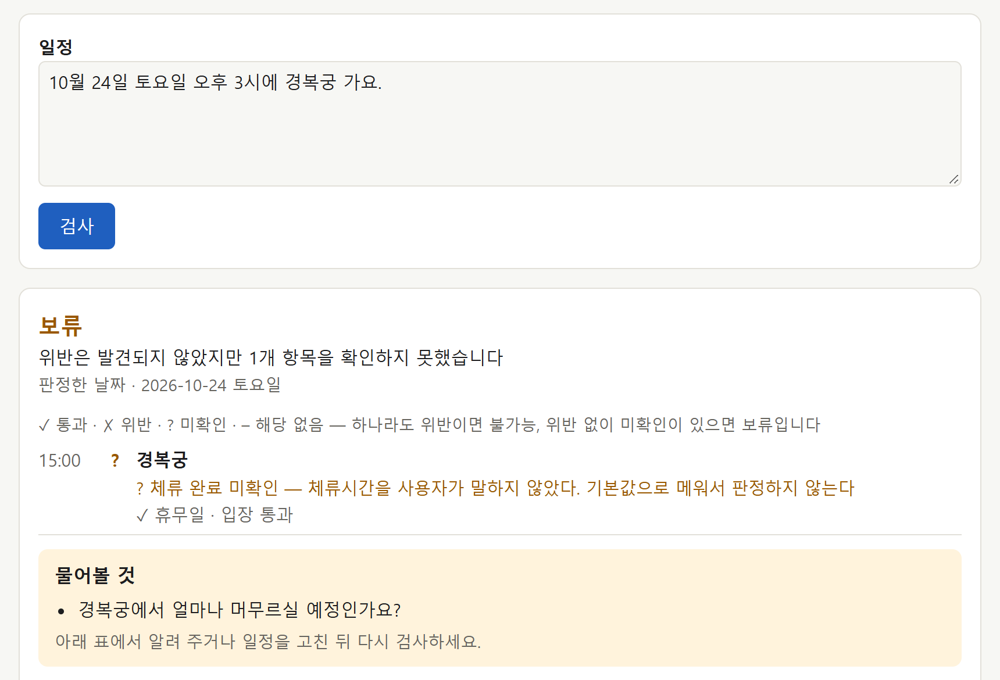
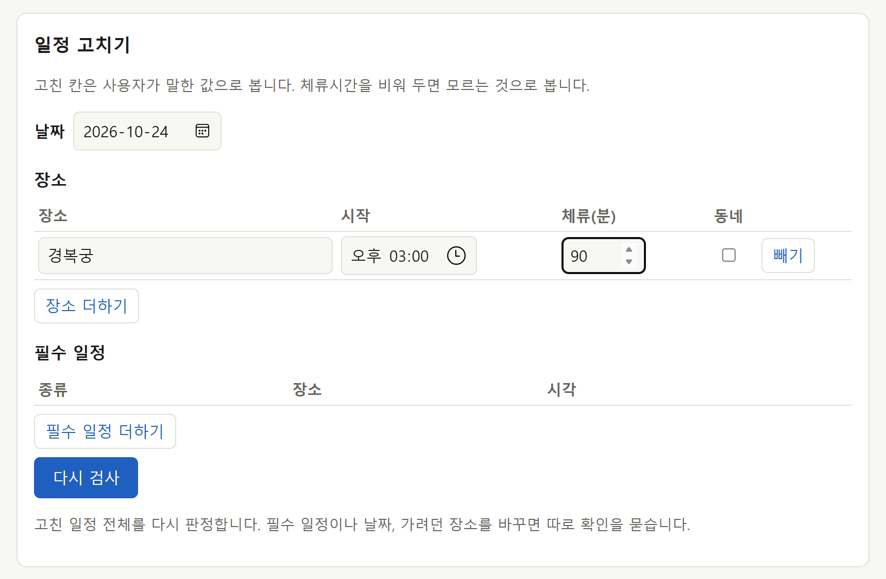

# itinerary-verifier

[](https://github.com/jeongrolee-tech/itinerary-verifier/actions/workflows/tests.yml)

여행 일정이 실제로 실행 가능한지 검증한다. **확인한 것 / 어긋난 것 / 확인하지 못한 것**을 근거와 함께 나눠서 낸다.

> Checks whether a travel itinerary is actually executable — validates opening hours,
> closures and transit times against official sources, and **reports what it could not verify**.

**목표 범위** — 서울 · 당일 · 장소 3\~6곳 · 대중교통.
제외 — 해외 도시 / 1박 이상 / 예약 / 예산 / 날씨 / 동선 최적화 / 다국어 / 자동차

**지금 확인할 수 있는 범위** — 모든 날의 운영정보를 확정할 수 있는 장소 4곳. 이동시간은 판정할 때 TMAP으로
받는다(`core/verify.py`). TMAP 없이 돌리는 정답 문제 중 T01\~T15는 저장해 둔 지하철 최소 이동시간 4개 구간만 쓰므로
**장소가 1곳이고 필수 일정(열차 등)이 없는 일정만 '가능'이 나올 수 있다.** T16\~T33은 문제에 적어 둔 테스트용
이동시간으로 장소 3\~6곳 일정과 열차 일정까지 판정한다.
자세한 것은 [지원 범위](#지원-범위).

> **용어가 낯설면** [`docs/용어.md`](docs/용어.md)를 먼저 보면 된다. 처음 읽는 사람이 알아듣는 말로 정리했고,
> 코드와 데이터에 남는 영어 값(`feasible` · `holdout` 등)과 이어 주는 대응표도 있다.

**목차** — 처음이면 [왜 만들었나](#왜-만들었나) → [무엇이 다른가](#무엇이-다른가) → [돌려보기](#돌려보기) → [현재 상태](#현재-상태) →
[어떻게 여기까지 왔나](#어떻게-여기까지-왔나) 다섯만 봐도 된다. 무엇을 만들었고, 어떻게 생겼고,
결과가 얼마고, 왜 이 모양이 됐는지가 그 다섯에 있다.
파일 하나하나의 설계 근거는 [`docs/파일별-역할.md`](docs/파일별-역할.md)에 따로 두었다. 필요할 때 찾아보는 용도다.

[왜 만들었나](#왜-만들었나) · [무엇이 다른가](#무엇이-다른가) · [돌려보기](#돌려보기) · [실행](#실행) ·
[현재 상태](#현재-상태) ·
[어떻게 여기까지 왔나](#어떻게-여기까지-왔나) · [구조](#구조) · [파일별 역할](#파일별-역할) ·
[판정 규칙](#판정-규칙) · [정답 문제](#정답-문제) ·
[데이터 소스](#데이터-소스) · [남은 작업](#남은-작업) · [라이선스](#라이선스)

## 왜 만들었나

여행 전에 일정을 확정하는 데 생각보다 시간이 오래 걸린다는 것을 여러 번 겪었다.
갈 곳마다 공식 페이지를 찾아 휴무일과 운영시간을 확인하고, 블로그와 유튜브에서
"월요일 휴관이래요" 같은 정보를 우연히 건진다. 그렇게 확정해도 현장에서 틀어질지는
끝까지 알 수 없다.

계획은 몇 주 전에 시작하더라도, **검증이 의미를 갖는 것은 방문일에 가까울수록**이다.
운영시간과 휴무일은 바뀌기 때문이다. 그래서 모든 근거에 유효기간을 붙여두고, 방문일이
그 기간을 벗어나면 판정하지 않는다 — 몇 달 뒤 일정을 지금 근거로 "괜찮다"고 말하지
않는다. 언제 쓰든 사전에 찾은 오류는 고칠 수 있지만, 현장에서 찾으면 그냥 손해다.

진짜 문제는 **처음 가는 도시**다. 아는 것이 없으니 확인할 것도 많다. 그런데 검증기를
만들려면 정답을 판정 코드가 아니라 **공식 페이지 문구에서** 만들어야 하고, 그러려면
내가 그 출처를 직접 읽을 수 있어야 한다. 그래서 **서울로 좁혔다.** 범위를 줄인 것이
아니라 검증이 성립하는 범위를 고른 것이다.

그래서 이걸 LLM에 맡기면 어디까지 되나. 그게 이 프로젝트의 질문이었고,
답은 [비교 실험](#비교-실험-claude-opus-5-5-effort-low-33건)에 있다 — **맡기면 안 되는 단계가 있었다.**
LLM은 자연어를 구조로 옮기는 데만 쓰고, 근거가 충분한지와 실행 가능한지는 코드가 판정한다.

---

## 무엇이 다른가

오류를 못 찾은 것과 문제가 없는 것은 다르다. 그래서 검사 결과를 참·거짓 둘로 두지 않는다.

```
검사 하나            통과        근거를 확보했고 조건을 만족했다
                     위반        확보한 근거에서 위반이 확인됐다
                     미확인      검사가 필요한데 끝내지 못했다
                     해당 없음   검사 자체가 성립하지 않는다
```

미확인이 없으면 서비스가 거짓말을 한다. 운영시간을 못 구한 것을 "문제 없음"으로 내기
때문이다. '해당 없음'을 따로 둔 이유도 같다 — **검사가 불필요한 것과 못 끝낸 것은
다르다.** 마지막 장소에 다음 구간이 없는 것은 미확인이 아니다.

일정 전체 판정은 이 검사들을 **가장 나쁜 상태로 접어서** 낸다. 다수결이 아니다.

```
일정 전체            불가능      위반이 하나라도 있다
                     보류        위반은 없지만 미확인이 있다
                     가능        필요한 검사가 모두 통과했다
```

'해당 없음'은 전체 판정을 끌어내리지 않는다. 잘못된 것이 아니기 때문이다.
반대로 미확인을 무시하고 "대부분 통과했으니 가능"을 내는 순간, 이 검증기는
확인하지 않은 것을 확인했다고 말하는 서비스가 된다.

그래서 사용자에게도 "실행 가능한 일정입니다"가 아니라 **"확인한 정보와 검사 범위 내에서
위반이 발견되지 않았습니다"**라고 말한다.

---

## 돌려보기

키 없이 바로 된다(`python core/run.py --case T08`). 정답 문제마다 검사별로 무엇을 확인했고 무엇을 못 했는지 나온다.
자연어 일정을 직접 넣어 보려면 Anthropic · TMAP 키가 필요하다(`core/verify.py`).
화면으로 보려면 `python core/app.py`를 켜고 http://127.0.0.1:8001 을 연다. 결과를 일정 순서대로 줄마다 ✓ 통과 · ✗ 위반 ·
? 미확인 · – 해당 없음으로 보여 주고, 빠진 정보를 묻고, 표에서 고친 일정을 다시 검사한다. 화면 맨 위에는 지금 운영시간과
휴무일을 확인할 수 있는 장소를 판정 코드로 골라 알린다. Anthropic 키는 있어야 하고 TMAP 키는 없어도 된다. 화면 캡처는
[화면으로](#화면으로--빠진-정보를-묻고-다시-검사한다)에 있다.
판정 세 가지가 각각 어떻게 생겼는지 아래 셋으로 보면 된다.
`[검사]`는 검사 하나하나의 상세이고, `[결과]`는 그것을 사용자에게 보여줄 묶음으로 나눈 것이다 —
어긋난 것 · 확인하지 못한 것 · 확인한 것 · 해당 없음, 그리고 이 서비스가 **검사하지 않는 것**.

### 보류 — 근거가 없어서 판단하지 않는다

```bash
python core/run.py --case T08
```

```
입력: 10월 8일 목요일 오후 4시 반에 경복궁 갈게요.

[추출한 일정]
  16:30  경복궁  체류 미입력

[적용한 기본값]
  A1  date = 2026-10-08  (extract.inferred_date)  ← 입력에 연도가 없어 구조화 추출 단계에서 가장 가까운 미래 날짜로 해석했다
  A2  stops[0].dwell_minutes = 90  (default_dwell.palace)  ← 체류시간 미입력. 장소 유형 기본값 적용

[검사]
  ○ 통과      CLOSED_DAY                 경복궁
      근거 공식 페이지에서 옮김 https://royal.khs.go.kr/... (확인 2026-09-21, 유효 ~2026-12-31)
  ○ 통과      ADMISSION_NOT_POSSIBLE     경복궁
      근거 공식 페이지에서 옮김 https://royal.khs.go.kr/... (확인 2026-09-21, 유효 ~2026-12-31)
  ? 미확인    DWELL_NOT_COMPLETABLE      경복궁
      → [NO_USER_DWELL] 체류시간을 사용자가 말하지 않았다. 기본값으로 메워서 판정하지 않는다
      해결(사용자) 경복궁에서 얼마나 머무르실 예정인가요?
  – 해당 없음 INSUFFICIENT_TRAVEL_TIME   경복궁 → (없음)
      → 마지막 장소라 다음 구간이 없다

[결과]  보류 — 위반은 발견되지 않았지만 1개 항목을 확인하지 못했습니다

  확인하지 못한 것 (1)
    ? 경복궁 체류 완료 — 체류시간을 사용자가 말하지 않았다. 기본값으로 메워서 판정하지 않는다
        물어볼 것: 경복궁에서 얼마나 머무르실 예정인가요?

  확인한 것 (2)
    ○ 경복궁 휴무일
    ○ 경복궁 입장

  해당 없음 (1)
    – 경복궁 → (없음) 이동 — 마지막 장소라 다음 구간이 없다

  검사하지 않는 것
    식당 대기시간 · 혼잡도 — 공식 출처가 없다
    당일 임시 휴무 · 행사 · 현장 상황 — 근거는 확인한 날의 공식 안내 페이지다
    예약 필요 여부 · 매진 · 가격 · 날씨
    사용자가 고른 이동수단으로 되는지 — 대중교통 · 도보 · 택시 중 하나로라도 갈 수 있으면 된다고 본다. 택시를 안 탄다고 했으면 택시만 뺀다
    동선 최적화 · 수정안 자동 생성 — 사용자가 고친 일정을 다시 검사하는 것까지만 한다

[판정]  보류
  통과 2 / 위반 0 / 미확인 1 / 해당 없음 1
```

휴무일도 입장도 통과했는데 전체 판정은 '가능'이 아니다.
체류시간을 사용자가 말하지 않았으니 우리가 정한 90분으로 메워서 판정하지 않는다.
대신 미확인을 내고 **사용자에게 무엇을 물어야 하는지**까지 같이 낸다.

### 불가능 — 확보한 근거에서 위반이 확인됐다

```bash
python core/run.py --case T15
```

```
입력: 10월 9일 금요일 저녁 6시 반에 서울시립미술관 서소문본관 갈게요. 한 시간 볼 거예요.

[추출한 일정]
  18:30  서울시립미술관 서소문본관  체류 60분 (사용자)

[적용한 기본값]
  A1  date = 2026-10-09  (extract.inferred_date)  ← 입력에 연도가 없어 구조화 추출 단계에서 가장 가까운 미래 날짜로 해석했다

[검사]
  ○ 통과      CLOSED_DAY                 서울시립미술관 서소문본관
      근거 공식 페이지에서 옮김 https://sema.seoul.go.kr/... (확인 2026-09-29, 유효 ~2026-12-31)
  ✕ 위반      ADMISSION_NOT_POSSIBLE     서울시립미술관 서소문본관
      → 입장마감(18:00) 이후 도착
      근거 공식 페이지에서 옮김 https://sema.seoul.go.kr/... (확인 2026-09-21, 유효 ~2026-12-31)
  – 해당 없음 DWELL_NOT_COMPLETABLE      서울시립미술관 서소문본관
      → 입장 여부가 확정되지 않아 체류 검사가 성립하지 않는다
  – 해당 없음 INSUFFICIENT_TRAVEL_TIME   서울시립미술관 서소문본관 → (없음)
      → 마지막 장소라 다음 구간이 없다

[결과]  불가능 — 확인한 정보에서 실행할 수 없는 부분이 발견되었습니다

  어긋난 것 (1)
    ✕ 서울시립미술관 서소문본관 입장 — 입장마감(18:00) 이후 도착

  확인한 것 (1)
    ○ 서울시립미술관 서소문본관 휴무일

  해당 없음 (2)
    – 서울시립미술관 서소문본관 체류 완료 — 입장 여부가 확정되지 않아 체류 검사가 성립하지 않는다
    – 서울시립미술관 서소문본관 → (없음) 이동 — 마지막 장소라 다음 구간이 없다

  검사하지 않는 것
    식당 대기시간 · 혼잡도 — 공식 출처가 없다
    당일 임시 휴무 · 행사 · 현장 상황 — 근거는 확인한 날의 공식 안내 페이지다
    예약 필요 여부 · 매진 · 가격 · 날씨
    사용자가 고른 이동수단으로 되는지 — 대중교통 · 도보 · 택시 중 하나로라도 갈 수 있으면 된다고 본다. 택시를 안 탄다고 했으면 택시만 뺀다
    동선 최적화 · 수정안 자동 생성 — 사용자가 고친 일정을 다시 검사하는 것까지만 한다

[판정]  불가능
  통과 1 / 위반 1 / 미확인 0 / 해당 없음 2
```

10월 9일 한글날은 **금요일이지만 공휴일이다.** 이 미술관은 금요일 21시까지지만 공휴일은
19시까지고 입장마감이 18:00이다. 요일만 보고 시간표를 고르면 18:30 입장을 통과시킨다.

### 가능 — 필요한 검사가 모두 통과했다

```bash
python core/run.py --case T10
```

```
입력: 10월 8일 목요일 오후 2시에 창덕궁 한 시간 반 보려고요.

[추출한 일정]
  14:00  창덕궁  체류 90분 (사용자)

[적용한 기본값]
  A1  date = 2026-10-08  (extract.inferred_date)  ← 입력에 연도가 없어 구조화 추출 단계에서 가장 가까운 미래 날짜로 해석했다

[검사]
  ○ 통과      CLOSED_DAY                 창덕궁
      근거 공식 페이지에서 옮김 https://royal.khs.go.kr/... (확인 2026-09-21, 유효 ~2026-12-31)
  ○ 통과      ADMISSION_NOT_POSSIBLE     창덕궁
      근거 공식 페이지에서 옮김 https://royal.khs.go.kr/... (확인 2026-09-22, 유효 ~2026-12-31)
  ○ 통과      DWELL_NOT_COMPLETABLE      창덕궁
  – 해당 없음 INSUFFICIENT_TRAVEL_TIME   창덕궁 → (없음)
      → 마지막 장소라 다음 구간이 없다

[결과]  가능 — 확인한 정보와 검사 범위 내에서 위반이 발견되지 않았습니다

  확인한 것 (3)
    ○ 창덕궁 휴무일
    ○ 창덕궁 입장
    ○ 창덕궁 체류 완료

  해당 없음 (1)
    – 창덕궁 → (없음) 이동 — 마지막 장소라 다음 구간이 없다

  검사하지 않는 것
    식당 대기시간 · 혼잡도 — 공식 출처가 없다
    당일 임시 휴무 · 행사 · 현장 상황 — 근거는 확인한 날의 공식 안내 페이지다
    예약 필요 여부 · 매진 · 가격 · 날씨
    사용자가 고른 이동수단으로 되는지 — 대중교통 · 도보 · 택시 중 하나로라도 갈 수 있으면 된다고 본다. 택시를 안 탄다고 했으면 택시만 뺀다
    동선 최적화 · 수정안 자동 생성 — 사용자가 고친 일정을 다시 검사하는 것까지만 한다

[판정]  가능
  통과 3 / 위반 0 / 미확인 0 / 해당 없음 1
```

'가능'은 **모든 검사에 근거가 있었을 때만** 나온다. 체류시간을 사용자가 말했고,
계절 시간표(9\~10월 09:00\~18:00, 입장마감 17:00)를 공식 페이지에서 확보했기 때문이다.
셋 중 하나라도 비면 위의 보류가 된다.
날짜는 연도를 추측해 채웠지만(`A1`), 말한 요일(목요일)이 그 날짜와 맞아서 확인된 것으로 본다. 추측했다는 기록만 남기고
판정은 막지 않는다.
그래도 `[결과]` 끝에는 검사하지 않는 것이 붙는다. '가능'은 "여행이 반드시 가능하다"가 아니라
이 목록을 뺀 범위에서 위반을 찾지 못했다는 뜻이기 때문이다.

> 33건 전부의 입력과 출력은 `python core/run.py --all` 로 한 번에 볼 수 있다.
> 문제 목록은 [정답 문제](#정답-문제)에 있다.

### 화면으로 — 빠진 정보를 묻고 다시 검사한다

`python core/app.py`로 켠 데모 화면이다. 2026-10-19에 Anthropic 키로 실제 추출해서 찍었고, TMAP 키는 넣지 않았다.
입력은 "10월 24일 토요일 오후 3시에 경복궁 가요." 하나다. 체류시간을 말하지 않아서 보류가 나오고, 무엇을 알려 주면
되는지 묻는다.



아래 표에서 체류시간에 90분을 넣는다. 고친 칸은 사용자가 말한 값으로 본다.



다시 검사하면 보류가 가능으로 바뀐다. 처음 일정에서 무엇이 바뀌었는지와, 검사마다 무엇을 보고 판정했는지(공식 안내
링크와 확인한 날)가 같이 나온다.


TMAP 키를 넣지 않은 것은 TMAP 이동시간을 받은 뒤 24시간 넘게 저장할 수 없어서다. 캡처에 찍혀 README에 남으면 그것도
저장이다. 장소를 하나로 고른 것도 같은 이유다. 장소가 여럿이면 이동시간을 TMAP으로 받아야 '가능'이 나올 수 있다.

---

## 실행

**필요한 것** — Python 3.10 이상. 조회 스크립트(`.mjs`)를 돌릴 때만 Node 18 이상.

```bash
pip install -r requirements.txt     # anthropic, pydantic, fastapi, uvicorn, httpx, pytest

# 키 없이 (판정 코드는 외부 API를 부르지 않는다)
python core/run.py                          # 정답 문제 채점 + 실행 기록
python core/run.py --case T05               # 문제 하나 상세
python core/run.py --all                    # 전부 상세
pytest                                      # 규칙 테스트 (정답 문제 33건 회귀 · 확정 위반 반례 · 예상 이동시간 · 길찾기 · 일정 검증 · 구조화 추출 · 결과 묶기 · 수정 재검사 · 실행 기록 · 모델 호출 · 응답 캐시 · 나간 돈 · 데모 API)
python core/compare.py --dry-run            # 비교 실험 배선 확인
python core/compare.py --arms code          # 비교 실험, 판정 코드만 (일부 실행 → last-compare-subset.json)
python core/build_transit_legs.py           # 지하철 최소 이동시간 계산
python core/eval_report.py                  # 평가 보고 — 실행 기록 세 개를 오류 유형별로 (docs/eval-report.md)

# Anthropic API 키 필요 — 단, 아래 두 평가는 받아 둔 응답이 있으면 키도 돈도 필요 없다 (응답 캐시)
python core/run_extract.py                  # 자연어 → 구조화 추출 → 판정
python core/compare.py                      # 비교 실험 — 비교 방식 넷
python core/compare.py --fresh              # 받아 둔 응답을 쓰지 않고 전부 새로 받는다 (돈이 든다)
python core/compare.py --model claude-sonnet-5-5
python core/app.py                          # 데모 화면 http://127.0.0.1:8001 — TMAP 키는 있으면 쓴다

# Anthropic API 키 + TMAP 앱 키 필요
python core/verify.py "10월 8일 목요일 …"   # 일정 하나를 끝까지 검증 — 아무것도 저장하지 않는다

# 공공데이터포털 API 키 필요
python core/fetch_holidays.py 2026          # 공휴일 데이터 다시 받기

# Google Maps Platform 키 필요 (판정에는 쓰지 않는다. 능력 확인용)
GKEY=... node check-places-api.mjs
GKEY=... node check-routes-api.mjs

# TMAP 앱 키 필요 (길찾기 능력 확인. 판정할 때 부르는 건 위 verify.py)
node check-tmap-api.mjs                     # 수단별로 경로가 오나 — 키를 물어본다
```

**평가 실행은 돈이 들기 전에 묻는다.** `run_extract.py`와 `compare.py`는 모델에 보낼 내용이 받아 둔 응답
(`core/response-cache.json`)과 같으면 그 응답을 쓰고 API를 부르지 않는다. 새로 부를 호출이 있으면 몇 건이고 얼마쯤
드는지 보여 준 뒤 `y`를 받아야 부른다. 저장소에는 2026-10-12에 받은 응답이 들어 있어서, 프롬프트와 데이터를 바꾸지
않았다면 두 명령은 키 없이 돌고 비용이 들지 않는다([`core/response_cache.py`](docs/파일별-역할.md#coreresponse_cachepy--응답-캐시)).

**돈이 드는 실행은 나간 돈을 찍는다** (`core/spend.py`). `run_extract.py` · `compare.py`는 새로 부를 때마다 그 호출의
비용과 누적을, 끝에는 이번 실행에서 나간 돈을 찍고 기록의 `responses.spent_usd`에도 남긴다. 기록의 '비용'은 응답을 받을 때
든 값이라 받아 둔 응답을 다시 쓴 실행에서도 같은 숫자가 나오는데, 이것은 이번에 실제로 나간 돈이다. `verify.py`는 끝날 때
(실패로 끝나도), 데모(`app.py`)는 요청마다 서버 창에 찍는다. `.mjs` 스크립트도 끝에 찍는다. Anthropic은 호출마다 금액을,
TMAP · Google은 건수와 요금 범위를 찍는다 — 무료 제공량을 오늘 · 이번 달에 이미 얼마나 썼는지는 각 콘솔에만 있어서다.
TMAP은 대중교통만 넘은 뒤 단가(건당 0.88원)를 확인했고, 나머지는 무료 제공량만 확인했다.

GitHub에 올릴 때마다 같은 `pytest`가 Python 3.10과 3.13에서 자동으로 돈다(GitHub Actions, `.github/workflows/tests.yml`).
외부 API를 부르지 않는 테스트라 키가 필요 없다.

Anthropic · TMAP · 공공데이터포털 키는 환경변수에 없으면 **실행할 때 물어본다.** 그렇게 넣으면 화면에 안 찍히고
셸 히스토리에도 안 남는다(공휴일 스크립트는 환경변수를 읽지 않고 바로 묻는다). Google 확인 스크립트 둘은 `GKEY`
환경변수로만 받는다. `--key=`로 넘길 수도 있지만 그러면 셸 히스토리에 남는다.
어떤 키가 필요한지는 위 주석대로이고, 판정 코드만 돌릴 거라면 키가 아예 필요 없다.

---

## 현재 상태

판정과 구조화 추출 기록은 2026-10-20에 코드 `269e46a` · 데이터 `facts-2026-10-20`으로 다시 만들었다. 구조화 추출은 모델에 보낼
내용이 그대로라 10월 12 · 14일에 받은 응답을 다시 썼다(이번 비용 $0, [응답 캐시](docs/파일별-역할.md#coreresponse_cachepy--응답-캐시)).
**비교 실험 기록은 2026-10-14 것(코드 `a40d69e` · `facts-2026-09-29`) 그대로다.** 'LLM에 사실 데이터 줌'은 사실 데이터 전체를
받아서, 종묘 데이터가 바뀐 지금 데이터로는 33건을 모두 다시 받아야 한다(약 $2.6). 남은 결정(README 남은 작업)이 끝난 뒤 한 번에
다시 돌린다. 판정 결과와 정답은 두 데이터에서 같다.
기록마다 코드 커밋과 입력 지문이 남아 있고, 구조화 추출과 비교 실험 기록에는 모델과 기준 날짜도 있다.

| | 결과 | 기록 |
| --- | --- | --- |
| 판정 (33건) | **33/33** — 연습용 9/9 · 시험용 24/24 | [`last-run.json`](core/last-run.json) `run-20261020-125931` |
| **보류인데 가능으로 낸 건수** | **0** | 〃 |
| 보류 비율 · 답을 준 비율 | 0.424 · 0.576 | 〃 |
| 구조화 추출 (자연어 → 구조) | **33/33** — 항목 여덟 개 모두 33/33 · claude-opus-5-5 · 기준 날짜 2026-09-22 · 응답을 처음 받을 때 $0.2875 | [`last-extract-run.json`](core/last-extract-run.json) `extract-20261020-125933` |
| 비교 실험 | 아래 표 | [`last-compare.json`](core/last-compare.json) `cmp-20261014-122357` |
| 보류 14건을 풀려면 | 데이터 확보 7건 · 사용자 답 5건 · 둘 다 2건 | [평가 보고](docs/eval-report.md) |

판정 · 구조화 추출 조건 — 코드 `269e46a` · 입력 지문 `tests.json` `b28d9fa8164c` · `facts.json` `5e2bb7b1fde0` · `policy.json` `1e3605504d71`.
비교 실험 조건 — 코드 `a40d69e` · `tests.json` `5cc757a28e02` · `facts.json` `e7500f29c6c7`.
정답은 지금 데이터 버전(`facts-2026-10-20`)에서 33건 모두 유효하다. 구조화 추출 채점 항목은 날짜·요일 · 연도 출처 · 장소 ·
시각 · 시각 출처 · 체류시간 · 지원 범위 분류 · 필수 일정이다.

**33/33을 읽는 법**

- **T16\~T33 18건은 결과를 보지 않고 정답을 먼저 커밋한 뒤 처음 돌린 결과다**(T16\~T29는 10월 6\~7일, T30\~T33은 10월 14일). 그래도 독립된 평가는 아니다. 정답 초안을
  쓴 Claude가 판정 코드도 함께 고쳐 왔다([정답 문제](#정답-문제)). 판정 규칙이 문서대로 구현됐는지 확인한 숫자로 읽는다.
  T01\~T15는 시험용 6건까지 포함해 9월 21일부터 결과를 여러 번 본 문제다.
- T01\~T15는 저장해 둔 지하철 최소 이동시간을 써서 장소가 둘 이상이면 '가능'이 나오지 않는다. T16\~T33은 문제에 적어 둔
  테스트용 이동시간을 쓴다. 판정할 때 TMAP을 부르는 실제 사용 경로(`core/verify.py`)는 이 기록에 들어 있지 않다.
- 구조화 추출은 문제마다 한 번 돌렸다. 같은 입력으로 여러 번 돌려 흔들림을 재지 않았다. 10월 1일과 6일 실행에서는 오전·오후가
  없는 시각의 출처가 실행마다 뒤집혔고, 그 뒤 프롬프트에 기준을 넣었다([`tests.json` 절](docs/파일별-역할.md#coretestsjson--정답-문제와-정답)의 오전·오후 기준).

**예전 숫자는 조건이 다른 숫자다** — 노션 실험기록과 이 README의 지난 판에 나온 숫자들이다.

| 숫자 | 언제 | 무엇을 셌나 | 조건 |
| --- | --- | --- | --- |
| 13/13 | 2026-09-21 | 판정 13건 (연습용 9 · 시험용 4) | Google Routes로 받아 저장해 둔 이동시간. 약관상 저장할 수 없어 다음 날 버렸다 |
| 구조화 추출 15/15 · 판정 15/15 | 2026-09-21 | 구조화 추출과 판정 15건 | claude-opus-5 · 기준 날짜 2026-09-21 · 위와 같은 날의 데이터 |
| 7/15 | 2026-09-22 | 판정이 정답과 맞은 건수 | 이동시간을 지하철 최소 이동시간으로 바꾸고 장소 4곳을 넣은 직후. 정답 8건이 옛 데이터를 전제하고 있었다. 같은 날 비교 실험도 정답이 맞는 7건만 채점했다 |
| 15/15 | 2026-09-22 | 판정 15건 | 정답 8건을 재검토한 뒤 |
| 판정 15/15 · 구조화 추출 15/15 | 2026-10-01 · 10-02 | 정답 문제 15건과 비교 실험 | 코드 `f6c50c1`. 오전·오후 기준 · 지원 범위 분류 · 구조화 추출 항목별 채점이 생기기 전이다. 비교 실험은 판정 코드 1.0 · LLM에 사실 데이터 줌 0.933(T01 보류인데 가능) · LLM에 그냥 물음 0.4(보류인데 가능 3) |
| 판정 29/29 · 구조화 추출 29/29 | 2026-10-07 | 정답 문제 29건과 비교 실험 | 코드 `6c6aa30`. 용어를 정리하기 전이다. 판정과 구조화 추출 결과는 10월 13일과 같다. 비교 실험은 LLM이 받은 것(모델 · 프롬프트 · 일정 · 사실 데이터)이 10월 12일과 같은데 LLM에 사실 데이터 줌이 0.897이었다(T15 · T24 불가능인데 보류) |
| 판정 29/29 · 구조화 추출 29/29 | 2026-10-12 · 10-13 | 정답 문제 29건과 비교 실험 | 코드 `f63d81a`. 3곳 이상 일정 4건(T30\~T33)을 더하기 전이다. 비교 실험은 판정 코드 1.0 · LLM에 사실 데이터 줌 0.931 · LLM에 그냥 물음 0.414(보류인데 가능 12) |

> **정답은 판정 코드와 독립이어야 하지만 데이터 버전과는 독립일 수 없다.** 7/15는 코드가 아니라
> 데이터가 바뀌어서 생긴 숫자였다.

### 비교 실험 (claude-opus-5-5, effort low, 33건)

같은 33건을 판정 방식 네 가지로 돌렸다. 기록 `cmp-20261014-122357`, 기준 날짜 2026-09-22. LLM 방식 셋의 응답은 29건은 10월 12일에
(`cmp-20261012-193020`), 새 문제 T30\~T33 4건은 10월 14일에(`cmp-20261014-120503`) 받은 것이다.

| | LLM에 그냥 물음 | LLM에 '모르면 모른다' 지시 | LLM에 사실 데이터 줌 | 판정 코드 |
| --- | --- | --- | --- | --- |
| 사실 데이터 | ❌ | ❌ | ✅ | ✅ |
| "근거 없으면 보류하라" 지시 | ❌ | ✅ | ✅ | — |
| 전체 정확도 | 0.424 | 0.455 | 0.939 | **1.0** |
| 정밀도 — 불가능이라고 한 것 중 맞은 비율 | 0.889 | 1.0 | 1.0 | 1.0 |
| 재현율 — 정답이 불가능인 것 중 찾은 비율 | 0.727 | 0.182 | 0.909 | 1.0 |
| 가능인데 불가능 (건) | 0 | 0 | 0 | 0 |
| 불가능인데 가능 (건) | 0 | 0 | 0 | 0 |
| **보류인데 가능 (건)** | **13** | **1** | **1** | **0** |
| 보류인데 불가능 (건) | 1 | 0 | 0 | 0 |
| 불가능인데 보류 (건) | 3 | 9 | 1 | 0 |
| 가능인데 보류 (건) | 2 | 8 | 0 | 0 |
| 보류 비율 | 0.152 | 0.909 | 0.424 | 0.424 |
| 답을 준 비율 | 0.848 | 0.091 | 0.576 | 0.576 |
| 건당 비용 | $0.0237 | $0.0161 | $0.0589 | **$0** |
| 지연 중앙값 (10월 12일 29건) | 10.2초 | 7.1초 | 10.8초 | **밀리초** |

정답 분포 — 불가능 11 · 가능 8 · 보류 14. 판정 코드의 1.0은 독립된 평가가 아니다(위 '33/33을 읽는 법').
지연 중앙값은 10월 12일 응답 29건 것이다. 그 응답은 호출별 지연 없이 중앙값만 남아 있어 새 4건과 합칠 수 없다.
갈래마다 어느 문제였는지는 [평가 보고](docs/eval-report.md)에 있다.

**1. 지시를 안 하면 근거 없이 통과시킨다** (LLM에 그냥 물음)

'LLM에 그냥 물음'과 "LLM에 '모르면 모른다' 지시"는 **입력이 완전히 같다.** 시스템 프롬프트만 다르고, 사실 데이터는 둘 다 받지 않았다.

```
지시 없음   보류 0.152   →  정답이 보류인 14건 중 13건을 가능으로 냈다
지시 있음   보류 0.909   →  거의 전부 보류. 보류인데 가능 1, 답을 준 비율 0.091
```

'LLM에 그냥 물음'은 `facts.json`을 한 줄도 받지 않았다. 그런데 **정답이 보류인 14건 중 13건을 가능이라고 했다.** 자기 지식으로
판단한 것이다. 지원 목록 밖 장소(T29 국립중앙박물관), 동네(T28 삼청동), 관이 여럿인 이름(T20 서울시립미술관),
다섯 곳 중 광장시장만 정보가 없는 T32도 다 가능이라고 했다. 오전·오후가 없는 T22 `"5시 반에 경복궁"`은 오후로 단정해 불가능을 냈다. 불가능이라고 한 9건 중 틀린 1건이
이것이다.

10월 2일 기록에서는 같은 15건(T01\~T15) 중 '보류인데 가능'이 3건이었는데 이번에는 7건이다. 그 사이 프롬프트의 검사 설명도 바뀌어서
원인을 하나로 말할 수는 없다.

> 1차 실험에서 "LLM에 '모르면 모른다' 지시"가 전부 보류한 것은 LLM의 성질이 아니라 **내 프롬프트의 결과**였다.
> 그것을 발견으로 읽지 않고 비교 방식을 하나 더 만든 것이 맞았다.

**2. '보류인데 가능' 0과 쓸모를 함께 가진 비교 방식은 하나뿐이다**

| 비교 방식 | 보류인데 가능 | 답을 준 비율 | |
| --- | --- | --- | --- |
| LLM에 그냥 물음 | 13 | 0.848 | 답은 많이 하지만 근거 없는 답이 섞여 있다 |
| LLM에 '모르면 모른다' 지시 | 1 | 0.091 | 거의 답하지 않는데도 확인 못 한 일정을 괜찮다고 한 적이 있다 |
| LLM에 사실 데이터 줌 | 1 | 0.576 | |
| **판정 코드** | **0** | **0.576** | **틀린 확신 없이 답을 준다** |

"LLM에 '모르면 모른다' 지시"는 "근거가 없으면 보류하라"는 지시를 받고도 T21 `"월요일 덕수궁 돌담길 산책"`을 가능으로 냈다. 길은 늘 열려
있다고 본 것이다. 서울시 안내로는 덕수궁 안을 지나는 구간이 월요일에 닫힌다(T21 설명). 모든 일정을 보류하면 '보류인데 가능'은 0이
되고 사용자가 얻는 것도 0이 된다. 그 둘을 함께 봐야 하는 이유가 이 표다.

**3. 정보를 주면 크게 나아지지만, 놓치는 규칙이 실행마다 바뀐다** (LLM에 사실 데이터 줌)

정확도 0.939로 코드와 2건 차이다. 새 문제 T30\~T33 4건은 모두 맞혔다.

- T15(한글날)를 보류로 냈다. 금요일 시간표(입장마감 20:00)와 공휴일 시간표(입장마감 18:00)가 둘 다 해당하는데
  "어느 쪽이 우선하는지 사실 데이터에 없다"는 이유였다. 그 말이 맞다. '공휴일 시간표가 요일 시간표보다 우선한다'는
  규칙은 판정 코드(`hours_for`)에만 있고, LLM이 받은 사실 데이터와 지시문에는 없다. 이 문제에서는 판정 코드가 규칙을
  하나 더 알고 있었던 셈이다. 같은 미술관에 공휴일인 금요일에 가는 T24(성탄절)에서는 공휴일 시간표를 골라 맞혔다.
- T27을 가능으로 냈다. '보류인데 가능'이다. 열차보다 10분 먼저 닿지만 권장 여유 15분에 5분 모자란다. 이 여유는 우리가 정한
  설정이라 위반은 아니지만, 사용자에게 확인받기 전에는 통과도 아니다.

10월 2일 기록에서는 같은 비교 방식이 T01을 가능으로 잘못 냈고 T15는 맞혔다. 10월 7일 기록에서는 T01을 맞히고 T15와 T24를
놓쳤다. 10월 12일에 받은 응답은 LLM이 받은 것이 10월 7일과 같은데 T24를 맞히고 T15만 놓쳤다. **어느 규칙을 놓치는지가
실행마다 바뀐다.** 코드는 같은 입력이면 언제나 같은 결과를 낸다.

```
그냥 물음 → '모르면 모른다' 지시     지시 효과        보류인데 가능 13 → 1.  단 답을 준 비율도 0.848 → 0.091
'모르면 모른다' 지시 → 사실 데이터    정보 제공 효과    정확도 0.455 → 0.939
사실 데이터 → 판정 코드              판정 방식 효과    보류인데 가능 1 → 0, 불가능인데 보류 1 → 0.  답을 준 비율은 0.576으로 같다
```

답을 준 비율이 같아도 답한 문제는 다르다. 사실 데이터를 받은 LLM은 보류해야 할 T27에 답했고, 답해야 할 T15를 보류했다.

> **한계** — 33건이라 정밀도·재현율의 신뢰구간은 여전히 넓다. '가능인데 불가능'은 분모가 가능 8건이라 아직 약하다.
> 반면 **'보류인데 가능' 건수는 "있다"를 확정하는 쪽이라** 표본이 작아도 유효하고, 보류 비율과 답을 준 비율은 비율로 읽을 수 있다.
>
> LLM 비교 방식은 문제마다 한 번씩만 돌렸다. 같은 조건으로 여러 번 돌려 흔들림을 재지 않았으므로
> 비교 방식 사이의 작은 차이는 읽지 않는다. 10월 7일 기록과 견주면 LLM이 받은 것이 같은데 답 87개 중 3개가
> 달랐다(LLM에 그냥 물음 T04 · T25, LLM에 사실 데이터 줌 T24).
>
> 7건만 채점했던 중간 결과에서는 'LLM에 그냥 물음'과 판정 코드의 보류 비율이 0.286으로 같게 나와
> "같은 결정성에서 코드가 더 정확하다"고 읽었는데, 15건에서는 그렇지 않았다.
> 표본이 작을 때 비율을 해석하면 이런 일이 생긴다.

---

## 어떻게 여기까지 왔나

지금 모양이 된 건 다섯 번의 수정 때문이고, **다섯 번 다 내가 틀린 것을 찾아서** 바뀌었다.

**1. 운영정보를 Google에서 가져올 수 없다** · 09-13

Places API는 후보 12곳 전부 `regularOpeningHours`를 반환했다. **채움률만 보면 12/12다.**
그런데 이 프로젝트의 검사가 요구하는 것으로 맞춰보면 입장마감 · 계절별 시간표 ·
공휴일 예외 규칙 · 적용기간이 **전부 없다.** 네 검사 중 셋이 성립하지 않는다.

→ 운영정보는 공식 페이지에서 사람이 확인해 넣고, Google은 `place_id`에만 쓴다.

**2. 이동시간 응답을 저장할 수 없다** · 09-21 → 09-22

Routes API로 구간 이동시간을 받아둔 뒤 약관을 확인했다. 소요시간·거리는 저장이 안 된다.
저장해 둔 데이터에 넣을 수 없으면 **고정 입력으로 테스트할 수 없다.** 판정 코드를 API에서
분리한 의미가 사라진다.

→ 서울교통공사 공공누리 데이터로 교체했다. 단 이건 **열차 탑승 시간뿐**이라
도보·환승·대기가 빠진 최소 이동시간이다. 그래서 최소 이동시간 전용 판정 규칙을 새로 만들었다 —
최소 이동시간으로도 늦으면 위반, 최소 이동시간으로 도착하면 미확인. 앞쪽은 10-05에 고쳤다.
지하철의 최소 이동시간일 뿐이라 택시로는 될 수 있어서, 지금은 최소 이동시간으로 늦어도 미확인이다.

**3. 첫 비교 실험 결과를 잘못 읽을 뻔했다** · 09-22

"LLM에 '모르면 모른다' 지시"가 15건을 전부 보류했다. "LLM은 원래 근거 판단을 못 한다"로 읽으면
**내 결론에 유리하다.** 그렇게 쓰지 않았다.

→ LLM의 성질이 아니라 내 프롬프트가 만든 결과일 수 있다고 보고, 지시를 뺀
'LLM에 그냥 물음'을 비교 방식으로 추가했다. 결과는 반대였다 — 사실 데이터를 한 줄도 안 받고도
정답이 보류인 7건 중 6건을 가능이라고 했다(10-02에 claude-opus-5-5로 다시 돌렸을 때는 3건).
**보류는 LLM의 성질이 아니라 지시의 효과였다.**

**4. 데이터를 고치니 정답이 바뀌었다** · 09-22

이동시간 출처를 교체하고 장소를 추가하자 15/15가 **7/15로 떨어졌다. 판정 코드는
건드리지 않았다.** 정답 8건이 옛 데이터 상태를 전제하고 있었던 것이다.

→ 코드 출력을 보지 않고 공식 출처로만 재검토해 6건을 갱신하고 2건은 문제 목적을
옮겼다. 이후로는 `facts.json`의 데이터 버전(`snapshot_id`)과 정답의 `labeled_against_snapshot`을
비교해 **재확인이 필요한 정답을 자동으로 찾는다.**

**5. 여러 장소 일정은 '가능'이 나올 수 없었다** · 10-02

2번에서 이동시간을 최소 이동시간으로 바꾼 뒤로 이동 검사는 통과가 나오지 않았다. 그래서 장소가 둘 이상이면
아무리 여유가 있어도 보류였다. T01은 미술관에서 2시에 나와 3시까지 경복궁에 가면 되고,
지하철로는 6.5분 거리다. 그런데도 판단을 보류했다. 한계로 적어 두고 넘어간 것이 문제였다.

→ 판정할 때 길찾기 API(TMAP)를 불러 쓰고 저장하지 않는다(`core/verify.py`). 9월 22일 데이터 정책에 계획으로
적어 두고 만들지 않았던 방법이다. 공공데이터로 상한선을 직접 만드는 안도 검토했지만, 길찾기 엔진을
다시 만드는 일이라 버렸다. 설계는 아래 '데이터 소스'의 '이동시간 — 실제로 쓸 때와 테스트할 때'에 있다.

> 폐기한 후보와 그 이유는 [`docs/experiments/`](docs/experiments/)에 날짜별로 있다.
> 채택한 설계만 README에 적고, 버린 것은 거기 남긴다.

---

## 구조

```
[조회]             외부 데이터를 받아 온다 · 실패 처리
       ↓           fetch_holidays.py (공휴일 API) · build_transit_legs.py (지하철 CSV)
       ↓           facts.json  (사실)   policy.json  (우리 기준)
       ↓           routes.py (TMAP 길찾기) — 판정할 때만 부르고 저장하지 않는다
[구조화 추출]      extract.py — 자연어를 구조로 옮긴다. 값을 채우지 않는다
       ↓           LLM 이 담당하는 유일한 단계
[판정 코드]        verdict.py — 순수 함수. 네트워크 호출 없음
       ↓           checks[] + hard_constraints[] + assumptions[]
[결과 묶기]        report.py — run.py · verify.py · app.py 화면용. 상태별로 묶고 검사하지 않는 것을 붙인다. 판정은 바꾸지 않는다
       ↓
[채점·기록]        run.py · run_extract.py · compare.py → last-*.json (실행 조건 포함 — runmeta.py)
[일정 하나]        verify.py — 구조화 추출 → 길찾기 → 판정 → 결과. 아무것도 저장하지 않는다
[데모]             app.py — 화면 한 장과 API 둘. 일정 하나 검증에 표로 고쳐 다시 검사하기를 더했다. 저장하지 않는다
```

판정 코드를 외부 API에서 분리했다. **API 없이 고정 입력으로 테스트할 수 있어야** 하기 때문이다.

### LLM과 코드의 경계

| 단계 | 담당 | 이유 |
| --- | --- | --- |
| 자연어 → 구조화 | **LLM** | 표현이 다양해 규칙으로 못 잡는다 |
| 장소 식별 · 운영정보 · 이동시간 조회 | 코드 | |
| **근거 충분성 판단** | **코드** | 미확인이 여기서 나온다 |
| 실행 가능 여부 판정 | **코드** | LLM은 규칙을 일관되게 적용하지 못했다 (위 비교 실험 — 놓치는 규칙이 실행마다 바뀌었다) |

---

## 파일별 역할

```
itinerary-verifier/
├── core/
│   ├── verdict.py               판정 코드          ← 이 프로젝트의 중심
│   ├── report.py                결과 묶기 (사용자 화면)
│   ├── extract.py               자연어 일정의 구조화 추출
│   ├── facts.json               사실
│   ├── policy.json              우리 기준
│   ├── tests.json               정답 문제와 정답
│   ├── transit-seoul-metro.csv  지하철 원본 (공공누리 1유형)
│   ├── holidays-2026.json       공휴일 원본
│   ├── fetch_holidays.py        공휴일 조회
│   ├── build_transit_legs.py    지하철 → 구간 최소 이동시간
│   ├── run.py                   판정 채점 + 기록
│   ├── labels.py                정답 재확인 필요 · 정답 대조 · 문제별 테스트용 이동시간 · 구조화 추출 채점 항목
│   ├── recheck.py               수정 후 전체 일정 재검사
│   ├── run_extract.py           구조화 추출 채점 + 끝까지 돌리기
│   ├── compare.py               비교 실험
│   ├── eval_report.py           평가 보고 — 세 기록을 오류 유형 · 보류 원인 · 비용으로 나눈다
│   ├── runmeta.py               실행 조건 기록 (코드 커밋 · 입력 지문 · 기준 날짜)
│   ├── model_info.py            기본 모델 · 단가 · 모델별 옵션
│   ├── llm.py                   Claude 호출 (구조화 출력 · 거부 처리)
│   ├── response_cache.py        응답 캐시 — 같은 요청이면 받아 둔 LLM 응답을 다시 쓰고, 돈이 들기 전에 묻는다
│   ├── spend.py                 이번 실행에서 나간 돈 — Claude 호출 비용 · TMAP 호출 건수를 세서 찍는다
│   ├── routes.py                TMAP 길찾기 (판정할 때만 부르고 저장하지 않는다)
│   ├── verify.py                일정 하나 검증 (Claude 구조화 추출 → TMAP 길찾기 → 판정)
│   ├── app.py                   데모 API (FastAPI) — 질문 · 판정 · 표에서 고쳐 다시 검사
│   ├── web/index.html           데모 화면 한 장
│   ├── response-cache.json      받아 둔 LLM 응답 (평가 실행이 쓴다)
│   └── last-*.json              실행 기록 (자동 생성)
├── docs/
│   ├── 용어.md                  용어 정리 — 처음 읽는 사람은 여기부터
│   ├── 파일별-역할.md           파일마다 하는 일과 설계 근거
│   ├── data-policy.md           제공사별 저장·공개 범위
│   ├── label-review-260922.md   정답 재검토 워크시트 (9월 22일)
│   ├── eval-report.md           평가 보고 (자동 생성)
│   ├── images/                  데모 화면 캡처
│   └── experiments/             실험 기록
├── tests/                       pytest 규칙 테스트
├── .github/workflows/tests.yml  올릴 때마다 pytest (GitHub Actions · Python 3.10 · 3.13)
├── check-places-api.mjs         Places API 능력 확인
├── check-routes-api.mjs         Routes API 모드 확인
├── check-tmap-api.mjs           TMAP 모드 확인
├── fetch-travel-times.mjs       Routes API 이동시간 조회
├── requirements.txt             구조화 추출·비교 실험·데모·테스트에만 필요한 패키지
├── CLAUDE.md                    Claude Code와 일할 때의 작업 규칙
└── LICENSE                      권리 보유 + 포함 데이터의 출처·이용 조건
```

파일마다 무엇을 하고 왜 그렇게 만들었는지는 [`docs/파일별-역할.md`](docs/파일별-역할.md)에 있다.
코드 안의 **⭐ 주석**이 그 파일에서 가장 중요한 결정이다.

---

## 판정 규칙

| 규칙 | 없으면 무엇이 깨지나 |
| --- | --- |
| 근거가 없으면 미확인 | 확인하지 않은 것을 확인했다고 말한다 |
| 해야 하는데 못 한 검사는 미확인, 해당 없음은 볼 필요가 없을 때만(쉬는 날 · 입장 불가). 입장을 확인하지 못하면 체류도 미확인 | 확인하지 못한 것을 '볼 필요 없음'으로 숨긴다(3차 피드백 T28) |
| 근거의 적용 기간(`valid_until`)이 지나면 못 쓴다 | 작년 시간표로 올해를 판정한다 |
| 입장 가능과 체류 완료는 다른 검사 | 16:30 입장은 되지만 2시간 뒤 폐장인 경우를 통과시킨다 |
| 체류시간을 사용자가 안 말했으면 체류 검사를 안 한다 | 우리가 정한 값으로 사용자 일정의 오류를 만들어낸다 |
| 체류를 모르면 0분으로 보고, 0분으로도 늦을 때만 이동 위반 | 추측한 체류시간으로 도착 불가를 확정한다 |
| 입장마감 정각 도착은 공식 안내가 '…까지 입장' 이라고 적은 곳(미술관)만 통과, 시각만 적힌 곳(궁궐)은 미확인 | 현장에서 정각에 막힌 일정을 통과시킨다(2026-10-09 종묘 17:00) |
| 필수 일정은 마지막 장소에서 출발한다고 계산한다. 그 시각보다 늦게 시작하는 장소가 있으면 하루 중간 일정이라 미확인(`MIDDAY_HARD_CONSTRAINT`). 그 일정을 사이에 둔 두 장소의 이동도 미확인 | 정오 약속을 오후 일정이 끝난 시각으로 판정해 위반을 만든다 |
| 필수 일정 시각을 모르면 조건을 버리지 않고 남겨서 시각을 묻는다 | 시각이 없다고 KTX 조건을 결과에서 빼, 꼭 타야 할 열차를 보지 않은 채 '가능' 을 낸다 |
| 쉬는 곳이 낀 이동도 다른 이동처럼 본다. 휴무는 휴무일 칸 하나가 위반으로 알린다 | 쉬는 곳 앞뒤 장소의 시각이 빠져도 이동을 '볼 필요 없음'으로 빼서 시각을 묻지 않는다(쉬는 곳이라도 일부러 갈 수 있다) |
| 개장 전 도착은 위반이 아니다. 개장 시각에 들어간 것으로 보고 체류·다음 이동을 거기서부터 센다 | 30분 기다리면 되는 일정을 불가능으로 판정한다 |
| 회차 입장(종묘 월·목·금)은 도착 뒤 첫 회차에 들어간다. 마지막 회차 뒤 도착은 위반, 해설(50분 정도)보다 긴 체류는 미확인 | 회차 사이 대기를 놓치거나 마지막 회차 뒤 도착을 '입장마감 전' 으로 통과시킨다 |
| LLM 이 추정한 시각·연도에 기대는 결과는 통과든 위반이든 확정하지 않는다 | "점심 먹고"를 12:00 으로 짐작해 입장 가능·불가를 단정한다 |
| 최소 이동시간으로 도착하면 미확인. 최소 이동시간으로도 늦으면 지하철로는 못 간다고 알리되 위반은 아니다 | 빠진 값(도보·환승·대기)을 0으로 취급한다 |
| 이동수단은 보지 않는다. 되는 수단이 하나라도 있으면 통과, 이동 0분으로도 늦을 때만 위반 | 택시로 갈 수 있는 일정을 불가능으로 판정한다 |
| 길찾기 예상 이동시간으로만 늦으면 미확인(`LATE_BY_ESTIMATE`). 위반은 이동 0분으로만 | 예상보다 빨리 가는 사람의 일정을 불가능으로 판정한다 |
| 예상 이동시간에 권장 여유(구간 10분, 열차 15분)를 더해도 닿으면 통과. 결과에 "통과 기준 · TMAP 예상 대중교통 23분에 권장 여유 10분을 더해도 15:00까지 닿는다"처럼 무엇에 기댔는지 적는다 | 예상치에 기댄 통과를 확인한 사실처럼 보여 준다 |
| 대중교통으로 통과가 안 나오면 택시 대안을 본다. 택시로 되면 통과이고 "택시로 가야 한다"를 요금 · 당일 교통 안내와 함께 붙인다. 택시를 안 탄다고 했으면 택시 대안을 보지 않는다 | 택시로 갈 수 있는 일정을 보류한다 |
| 권장 여유 기준이 없는 필수 일정(항공편)은 통과를 내지 않는다 | 근거 없는 여유로 항공편을 탈 수 있다고 한다 |
| 정보가 부족해도 심각도(`severity`)를 낮추지 않는다 | KTX 문제가 "중요도 낮음"으로 보여 확인을 건너뛴다 |
| 공휴일 시간표가 요일 시간표보다 우선한다 | 한글날(금)에 금요일 시간표를 골라 통과시킨다 |
| '해당 없음'도 근거가 필요하다 | "검사 불필요"를 근거 없이 주장한다 |

---

## 정답 문제

정답은 판정 코드의 출력을 보지 않고 공식 페이지 문구에서 만들었다. T16\~T33은 결과를 보지 않은 시험용 문제다 — 2026-10-06 · 10-07 · 10-14에
Claude가 초안을 쓰고 사용자가 확인한 뒤, 처음 돌리기 전에 커밋했다. 초안을 쓴 Claude는 판정 코드를 함께 고쳐 온 쪽이라
코드를 모르는 상태가 아니다. 그래서 정답은 코드가 아니라 위 판정 규칙과 공식 근거로 정했고, 새 18건은 정답을 커밋하기
전에 코드로 돌리거나 결과를 본 적이 없다.

아래가 33건 전부다. `입력`은 `tests.json`에 들어 있는 문장 그대로다.
상세 출력은 `python core/run.py --case T05` 처럼 문제를 지정하면 볼 수 있다.

| | 입력 (그대로) | 정답 | 잡아내는 것 |
| --- | --- | --- | --- |
| **T01**<br>연습용 | 10월 8일 목요일이요. 오후 1시에 서울시립미술관 서소문본관에서 한 시간 정도 보고, 3시에 경복궁 가려고 합니다. 두 시간 정도 볼 거예요. | 보류 | 이동 근거가 최소 이동시간(6.5분)뿐이라 15:00 도착을 확정할 수 없다. 최소 이동시간을 확정값처럼 쓰는 구현 |
| **T02**<br>연습용 | 10월 8일 목요일 오후에 17시 30분에 경복궁 들어가서 한 시간 정도 보려고요. | 불가능 | 폐장(18:00) 전이지만 입장마감(17:00)을 지났다. 운영시간 안이면 입장 가능이라고 보는 구현 |
| **T03**<br>연습용 | 10월 8일 목요일이요. 오후 3시에 경복궁 두 시간 보고, 6시에 광장시장에서 저녁 먹으려고요. | 보류 | 광장시장은 점포마다 달라 시장 단위 운영정보가 없다. 오류를 못 찾은 것을 문제없음으로 내는 구현 |
| **T04**<br>연습용 | …17시 30분에 경복궁 들어가서 한 시간 정도 보고, 19시에 광장시장에서 저녁을 먹은 다음 20시 30분 서울역에서 KTX를 탑니다. **이 기차는 꼭 타야 해요.** | 불가능 | 위반은 입장마감(17:00)에서 확정된다. KTX 쪽은 열차 출발 시각(사용자)과 15분 전 도착(우리 기준)을 한 덩어리로 섞는 구현을 잡는다 |
| **T05**<br>시험용 | 2026년 10월 6일 화요일에 고궁 투어를 하려고 합니다. 오전 10시 경복궁, 오후 2시 창덕궁. | 불가능 | 10/5(월)이 개천절 대체공휴일이라 창덕궁 휴궁이 10/6(화)로 밀린다. 요일 lookup만 하는 구현 |
| **T06**<br>시험용 | 10월 6일 화요일에 서울시립미술관 서소문본관 오후 2시에 한 시간 보려고요. | 가능 | 같은 날인데 궁궐은 휴궁, 미술관은 개관. 휴무 규칙을 코드에 박는 구현 |
| **T07**<br>연습용 | 10월 8일 목요일 오후 4시 반에 경복궁 들어가서 두 시간 볼 거예요. | 불가능 | 16:30 입장은 되지만 2시간이면 18:30, 폐장은 18:00. 입장과 체류 완료를 한 검사로 묶는 구현 |
| **T08**<br>연습용 | 10월 8일 목요일 오후 4시 반에 경복궁 갈게요. | 보류 | 체류시간을 안 말했다. 기본값으로 메워 판정하는 구현 |
| **T09**<br>시험용 | 11월 5일 목요일 오후 4시 반에 경복궁 들어가서 한 시간 볼게요. | 불가능 | 11월은 입장마감 16:00으로 10월과 한 시간 다르다. 연중 같은 시간으로 처리하는 구현 |
| **T10**<br>연습용 | 10월 8일 목요일 오후 2시에 창덕궁 한 시간 반 보려고요. | 가능 | 계절 3구간 중 9\~10월 행을 고르나 (가능이 나와야 하는 문제) |
| **T11**<br>연습용 | 10월 8일 목요일 오전 11시에 광장시장에서 밥 먹고 오후 1시에 경복궁 갈게요. | 보류 | 광장시장 → 경복궁 방향이 저장해 둔 데이터에 없다. 반대 방향 값으로 이 방향을 아는 척하는 구현 |
| **T12**<br>시험용 | 10월 8일 목요일 오후 1시에 경복궁 보고 3시 15분에 광장시장 갈게요. | 보류 | 체류시간을 말하지 않았다. 바로 나와도 13:04 도착이라 늦는다고 할 수 없고, 얼마나 머물지 몰라 도착한다고도 할 수 없다. 기본값으로 "된다" 고 판정하는 구현 — 단 이동이 최소 이동시간뿐이라 지금은 변별력이 약하다. 기본값으로 위반을 내는 구현은 pytest 반례 B 가 잡는다 |
| **T13**<br>연습용 | 10월 8일 목요일 오전 10시에 종묘 한 시간 보려고요. | 보류 | 목요일은 회차 입장이라 10:20 회차에 들어간다. 해설 관람이 50분 정도라 한 시간 머물 수 있는지 공식 안내가 없다. 회차를 연속 운영시간처럼 보거나 '50분 정도' 를 한 시간과 같다고 보는 구현 |
| **T14**<br>시험용 | **2027년** 3월 5일 금요일 오후 1시에 경복궁 두 시간 보려고요. | 보류 | 근거 유효기간이 2026-12-31이다. 조회 시각만 보고 적용하는 구현 |
| **T15**<br>시험용 | 10월 9일 금요일 저녁 6시 반에 서울시립미술관 서소문본관 갈게요. 한 시간 볼 거예요. | 불가능 | 한글날은 금요일이자 공휴일. 요일만 보고 시간표를 고르는 구현 |
| **T16**<br>시험용 | 10월 17일 토요일에 하루 종일 돌아다니려고요. 오전 9시 반에 경복궁 들어가서 두 시간 보고, 오후 1시에 창덕궁 한 시간 반, 오후 3시에 종묘 한 시간, 오후 4시 반에 서울시립미술관 서소문본관 한 시간, 저녁 6시에 덕수궁 가서 한 시간 반 볼게요. | 가능 | 다섯 곳이 모두 열고, 테스트용 이동시간에 권장 여유 10분을 더해도 제때 닿는다. 장소가 많으면 확정하지 못하는 구현 |
| **T17**<br>시험용 | 10월 18일 일요일 일정이에요. … 오후 1시에 경복궁 들어가서 두 시간 보고, 오후 2시 반에 창덕궁 한 시간 반, 오후 4시 반에 종묘 한 시간, 저녁 6시에 청계천 한 시간 걸을게요. | 불가능 | 여섯 곳 중 셋째 → 넷째 구간이 이동 0분으로도 늦는다. 앞 몇 곳만 보거나, 예상 이동시간으로 계산해 보류하는 구현 |
| **T18**<br>시험용 | 10월 9일 금요일 한글날에 오후 2시에 종묘 가서 한 시간 볼게요. | 가능 | 종묘는 금요일이 회차 입장이지만 공휴일은 일반관람이다. 요일만 보고 회차 입장으로 처리하는 구현 |
| **T19**<br>시험용 | 10월 14일 수요일 저녁 7시에 서울시립미술관 서소문본관 들어가서 한 시간 볼게요. | 가능 | 입장마감 정각(19:00)에 들어가 폐장 정각(20:00)에 끝난다. '관람 종료 1시간 전까지' 를 미만으로 처리하는 구현 |
| **T20**<br>시험용 | 10월 8일 목요일 오후 2시에 서울시립미술관 가서 한 시간 볼게요. | 보류 | 서울시립미술관은 관이 여럿이다. 이름이 비슷한 서소문본관으로 바꿔 판정하는 구현 |
| **T21**<br>시험용 | 10월 12일 월요일 오후 3시에 덕수궁 돌담길 산책하려고요. 한 시간 정도 걸을게요. | 보류 | 돌담길은 덕수궁 경내와 다른 대상이다. 이름만 보고 휴궁을 적용하는 구현, 늘 열려 있다고 단정하는 구현 |
| **T22**<br>시험용 | 10월 8일 목요일 5시 반에 경복궁 들어가서 한 시간 볼게요. | 보류 | 오전·오후가 없다. 오후로 단정해 입장 불가를 확정하는 구현 |
| **T23**<br>시험용 | 10월 15일 목요일 오후 1시에 서울시립미술관 서소문본관에서 한 시간 보고, 3시에 덕수궁 가서 한 시간 반 볼게요. | 가능 | `3시`는 앞의 '오후 1시'를 이어받아 15:00이다. 추측으로 보고 되묻는 구현, 새벽 3시로 읽는 구현 |
| **T24**<br>시험용 | 12월 25일 금요일 크리스마스에 오후 5시 반에 서울시립미술관 서소문본관 들어가서 한 시간 보고, 저녁 7시에 광장시장에서 저녁 먹을게요. | 불가능 | 성탄절은 겨울 공휴일 시간표(입장마감 17:00)다. 금요일 시간표를 고르는 구현, 광장시장 정보가 없다고 위반을 보류로 덮는 구현 |
| **T25**<br>시험용 | 10월 12일 월요일 오전 10시에 덕수궁 한 시간 보고, 오후 1시에 경복궁 갈게요. | 불가능 | 덕수궁 월요일 휴궁이 확정이다. 경복궁 체류시간을 모른다고 전체를 보류하는 구현 |
| **T26**<br>시험용 | 10월 15일 목요일 저녁 7시에 덕수궁 들어가서 한 시간 반 볼 거예요. 밤 8시 15분에 서울역에서 KTX를 타는데, 이 기차는 꼭 타야 해요. | 불가능 | 이동 0분이어도 열차를 못 탄다. 이동시간이 없다고 보류하는 구현 |
| **T27**<br>시험용 | 10월 15일 목요일 오후 6시에 덕수궁 들어가서 두 시간 보고, 저녁 8시 반에 서울역에서 KTX 탈 거예요. 꼭 타야 하는 기차예요. | 보류 | 열차 전에 닿지만 권장 여유 15분에 5분 모자란다. 우리가 정한 여유로 불가능을 확정하는 구현 |
| **T28**<br>시험용 | 10월 15일 목요일 낮 12시에 삼청동에서 점심 먹고, 오후 2시에 경복궁 가서 두 시간 볼게요. | 보류 | 삼청동은 동네라 갈 가게를 묻는다. 아무 식당이나 골라 판정하는 구현, 지원 목록 밖 장소처럼 넘기는 구현 |
| **T29**<br>시험용 | 10월 15일 목요일 오전 10시에 국립중앙박물관 두 시간 보고, 오후 1시 반에 덕수궁 가서 한 시간 볼게요. | 보류 | 국립중앙박물관은 지원 목록 밖이라 확인하지 않는다. 이동은 판정한다. 일반 지식으로 운영시간을 메우는 구현, 동네처럼 이동까지 보류하는 구현 |
| **T30**<br>시험용 | 10월 23일 금요일 오후 2시에 경복궁 들어가서 두 시간 보고, 4시 반에 덕수궁에서 한 시간 반, 저녁 7시 반에 서울시립미술관 서소문본관 가서 한 시간 볼게요. | 가능 | 미술관은 금요일만 21:00까지(입장마감 20:00)라 19:30에 들어간다. 화\~목 시간표로 입장 불가를 내는 구현 |
| **T31**<br>시험용 | 10월 20일 화요일 오전 10시에 창덕궁 들어가서 한 시간 반 보고, 낮 12시 반에 경복궁 두 시간, 오후 3시에 덕수궁 한 시간, 오후 5시에 서울시립미술관 서소문본관에서 한 시간 볼게요. | 불가능 | 네 곳 중 경복궁만 화요일 정기휴일이다. 궁마다 쉬는 요일을 같게 보는 구현, 장소가 많을 때 일부만 검사하는 구현 |
| **T32**<br>시험용 | 10월 21일 수요일 오전 9시 반에 경복궁에서 한 시간 보고, 11시 반에 창덕궁 한 시간, 오후 1시에 광장시장에서 한 시간 동안 점심 먹고, 오후 3시에 덕수궁 한 시간, 오후 4시 반에 서울시립미술관 서소문본관에서 한 시간 반 볼게요. | 보류 | 다섯 곳 중 광장시장만 운영정보가 없다. 빈 정보를 통과로 넘기는 구현, 다른 장소 · 구간까지 미확인으로 번지게 하는 구현 |
| **T33**<br>시험용 | 10월 16일 금요일 오전 9시 반에 창덕궁 가서 한 시간 보고, 11시 반에 경복궁 두 시간, 오후 2시에 덕수궁에서 한 시간 반 본 다음, 오후 4시 반에 서울역에서 KTX를 꼭 타야 해요. | 가능 | 세 곳 뒤 열차도 권장 여유 15분을 더해 제때 닿는다. 열차가 걸리면 가능을 못 내는 구현, 서울역을 방문 장소로 넣는 구현 |

'보류인데 가능'(확인하지 못한 일정을 괜찮다고 한 것) — 비교 실험 기록(`cmp-20261014-122357`) 기준으로 'LLM에 사실 데이터 줌'은 T27,
"LLM에 '모르면 모른다' 지시"는 T21, 'LLM에 그냥 물음'은 13건(T01 · T03 · T08 · T11 · T12 · T13 · T14 · T20 · T21 · T27 · T28 · T29 · T32)에서 냈다.
10월 2일 기록에서는 'LLM에 사실 데이터 줌'이 T01, 'LLM에 그냥 물음'이 T03 · T08 · T13에서 냈다 — LLM 비교 방식은 실행마다 이 오류가 나는 문제가 바뀐다.

정답 분포 — T01\~T15는 불가능 6 · 가능 2 · 보류 7, T16\~T33은 불가능 5 · 가능 6 · 보류 7.
보류가 절반인 것은 데이터가 부족해서다. 그 부족을 **감추지 않는 것**이 이 프로젝트의 주장이다.

**T05와 T06은 같은 날(2026-10-06)인데 정답이 반대다.** 궁궐은 휴궁, 미술관은 개관. 휴무 규칙을 코드에 박으면 하나는 반드시 틀린다.

---

## 데이터 소스

### 지금 쓰는 것 — 저장·공개가 허용된 출처만

| 용도 | 출처 | 이용 조건 | 확인 |
| --- | --- | --- | --- |
| 공휴일 | 공공데이터포털 특일 정보 | 제한 없음 | API 호출 + 원본 응답 저장 (22건) |
| 지하철 탑승 시간 | 서울교통공사 OA-12034 | 공공누리 1유형 | CSV + 계산 스크립트 |
| 궁궐 휴무일·관람시간 | 국가유산청 궁능유적본부 | 출처 표시 | 공식 페이지 화면 확인 |
| 미술관 운영시간·휴관 규칙 | 서울시립미술관 관람안내 | 출처 표시 | 공식 페이지 화면 확인 |

Google Places·Routes와 TMAP은 **판정할 때 불러 쓸 수는 있지만 저장해 둘 수는 없다.**
근거는 [`docs/data-policy.md`](docs/data-policy.md).

### 이동시간 — 실제로 쓸 때와 테스트할 때

> **지금 상태** — `core/verify.py`가 판정할 때 TMAP을 불러 쓴다. 정답 문제와 비교 실험에서 T01\~T15는 저장해 둔
> 지하철 최소 이동시간을 써서 장소가 둘 이상이면 '가능'이 나오지 않는다. T16\~T33은 문제에 적어 둔 테스트용 이동시간을 쓴다.

문 앞에서 문 앞까지 걸리는 시간은 길찾기 API만 알려 준다. 그런데 Google · 카카오 · 네이버 · ODsay · TMAP
다섯 곳 모두 결과를 저장하지 못하게 한다. 그래서 판정 코드는 하나로 두고, 넣는 데이터만 나눈다.

실제로 쓸 때는 **TMAP**을 부른다. 대중교통 · 걷기 · 자동차를 한 곳에서 주고, 대중교통은 출발 시각도 정할 수 있다.
Google은 한국에서 대중교통 경로만 줘서(걷기 · 자동차는 빈 결과, 09-13 실험) 걷기를 붙이려면 어차피 하나를 더
써야 한다. 다섯 곳의 비교는 [`docs/data-policy.md`의 '길찾기 플랫폼별로 되는 것'](docs/data-policy.md#7-길찾기-플랫폼별로-되는-것--2026-10-02-확인)에 있다. 장소 좌표도 판정할 때 TMAP
장소 검색으로 받는다(입구 좌표). 저장해 둔 좌표는 없다.

| | 실제로 쓸 때 | 테스트할 때 |
| --- | --- | --- |
| 이동시간 | 판정하는 순간 TMAP으로 조회한다. 걷기·환승·대기가 들어간 예상치다 | 우리가 정한 값, 또는 저장해 둔 지하철 최소 이동시간 |
| 저장 | 하지 않는다. 결과에 "TMAP 예상 이동시간 기준"을 적는다 | 레포에 커밋한다 |
| T01 | 예상 시간에 권장 여유 10분을 더해도 3시 전이면 가능 | 정답 문제에서는 보류 — 걷는 시간을 모른다 |

**테스트에 정한 값을 넣어도 되는 이유.** 테스트는 같은 입력이면 언제나 같은 결과가 나와야 한다.
그때그때 바뀌고 저장도 못 하는 값은 쓸 수 없다. 그리고 테스트가 확인할 것은 TMAP 값이 맞는지가 아니라
"이동시간이 이만큼이면 판정이 맞게 나오는가"다. 미술관 → 경복궁을 25분으로 정하면 '가능'이,
55분으로 정하면 3시 전에 닿기는 하지만 권장 여유가 모자라 사용자 확인이 나와야 한다.
정한 값에는 테스트용이라는 표시를 붙여 실제 데이터와 섞이지 않게 한다.

| 테스트 | 이동시간 | 확인하는 것 |
| --- | --- | --- |
| 판정 규칙 (pytest) | 우리가 정한 값 | 장소 2\~3곳 일정의 '가능'까지 규칙대로 나오나 |
| 정답 문제 · 비교 실험 T01\~T15 | 저장해 둔 지하철 최소 이동시간 | 지금처럼 |
| 정답 문제 · 비교 실험 T16\~T33 | 문제에 정한 값(`legs`) | 장소 3\~6곳 일정과 열차 일정이 규칙대로 판정되나 |
| 길찾기 호출 | TMAP 응답을 흉내 낸 가짜 응답 | 시간을 제대로 읽나, 빈 결과 · 시간 초과를 '확인 못 함'으로 두나 |

**불가능은 예상치로 확정하지 않는다.** 이동 때문에 확정하는 것은 이동시간 0분으로도 늦을 때뿐이다.
지하철 최소 이동시간으로도 늦으면 지하철로는 못 간다고 알린다. TMAP 예상으로만 늦으면
"늦을 가능성이 높다"고 알리고 사용자에게 묻는다. 걸음이 빠르거나 앞 열차를 타면 더 일찍 닿을 수 있다.
확정 위반이 추정치에 기대면 안 된다는 2차 피드백과 같은 원칙이다.

**한계.** TMAP 결과는 저장 후 24시간 넘게 쓸 수 없어서 판정할 때만 쓴다. 아주 가까운 구간은 대중교통 결과를 주지
않는다(코드 11 "출발지와 도착지가 너무 가까움"). 그때는 걷기 경로로 판정한다. 사용자가 고른 이동수단은
보지 않는다 — 되는 수단이 하나라도 있으면 된다(2026-10-05 결정). "걸어서 갈게요"라고 해도 대중교통으로 되면
'가능'이고, 결과의 '검사하지 않는 것'에 그렇다고 적는다. 다만 "택시는 안 타요"라고 하면 택시는 빼고 본다(3차 피드백). 자동차는 타임머신 자동차 길 안내로 출발
시각을 넣을 수 있다(2026-10-05 확인). 이때 `predictionType`은 이름과 반대로 읽어야 한다 — `arrival`이 출발
시각을 넣고 도착을 예측하고, `departure`는 도착 시각을 넣으면 출발 시각을 예측한다.

### 지원 범위

**무엇을 검사하나** — '가능'은 아래 "검사하는 것" 중 어긋난 것을 찾지 못했다는 뜻이다.
"검사하지 않는 것"은 보장하지 않는다.

| 검사하는 것 | 검사하지 않는 것 |
| --- | --- |
| 휴무일 — 정기휴일, 고정 휴관일, 공휴일이 겹칠 때의 기관별 규칙 | 식당 대기시간 · 혼잡도 — 공식 출처가 없다 |
| 입장 — 운영시간, 입장마감, 계절·공휴일 시간표 | 당일 임시 휴무 · 행사 · 현장 상황 — 근거는 확인한 날의 공식 안내 페이지다 |
| 체류 완료 — 사용자가 말한 체류시간이 폐장 전에 끝나나 | 예약 필요 여부 · 매진 · 가격 · 날씨 |
| 이동 — 판정할 때 TMAP 예상 이동시간(대중교통 · 도보 · 택시). TMAP 없이 돌리면 지하철 최소 이동시간 | 사용자가 고른 이동수단으로 되는지 — 대중교통 · 도보 · 택시 중 하나로라도 갈 수 있으면 된다고 본다. 택시를 안 탄다고 했으면 택시만 뺀다 |
| 필수 일정 — 사용자가 "꼭" 지킨다고 한 열차 등의 시각. 지금은 하루 마지막 교통편만 판정하고, 하루 중간의 약속은 미확인으로 알린다 | 동선 최적화 · 수정안 자동 생성 — 사용자가 고친 일정을 다시 검사하는 것까지만 한다 |
| 입력 — 날짜 · 장소 · 시각이 있나, 날짜와 요일이 맞나 | |

아래 표는 `facts-2026-10-20` 기준이다. 판정 코드를 공휴일이 없는 한 주(2026-10-12\~18) 동안
장소마다 돌려서 **실제로 확정되는 것**만 적었다. 데이터가 있어도 검사가 없으면 확정되지 않는다.
근거의 적용 기간은 모두 2026-12-31 까지다.
2026-10-22에 다섯 곳의 공식 페이지를 다시 열어 운영시간 · 입장마감 · 휴일 규칙 · 종묘 회차가 이 데이터와 같은 것을
확인했다. 날짜가 적힌 임시 휴관 · 공사 공지는 없었다. 값이 같아 데이터 버전은 그대로 두었다.

**장소** — 장소 1곳의 휴무일·입장·체류를 확정할 수 있나

| 장소 | 휴무일 | 입장 (운영시간) | 체류 완료 | 한계 |
| --- | --- | --- | --- | --- |
| 경복궁 | 확정 | 확정 | 체류를 말하면 확정 | 계절 시간표 3구간 |
| 서울시립미술관 서소문본관 | 확정 | 확정 | 〃 | 1월 1일이 월요일인 해는 `RULE_CONFLICT` |
| 창덕궁 | 확정 | 확정 | 〃 | 계절 시간표 3구간 |
| 덕수궁 | 확정 | 확정 | 〃 | |
| 종묘 | 확정 | 확정 — 월·목·금은 회차 입장(도착 뒤 첫 한국어 회차) | 〃 — 월·목·금은 해설(50분 정도) 안이면 확정 | 회차 입장 날 50분을 넘는 체류는 `DWELL_BEYOND_TOUR` |
| 청계천 · 덕수궁 돌담길 | 미확인 | 미확인 | — | 상시 개방이라는 공식 근거를 확보하지 않았다(`UNVERIFIED_ALWAYS_OPEN`) |
| 광장시장 | 미확인 | 미확인 | — | 점포마다 달라 시장 단위 정보가 없다. 미확인이 정답이다 |
| 북촌한옥마을 | 미확인 | 미확인 | — | 동네라 방문할 시설이 특정되지 않는다. 미확인이 정답이다 |

표에 없는 장소는 `UNSUPPORTED_PLACE`로, 동네는 `PLACE_NOT_RESOLVED`로 보류한다. 둘 다 미확인이지만 푸는 쪽이
다르다 — 표에 없는 장소는 우리가 정보를 확보해야 하고, 동네는 사용자가 어디로 가는지 알려 주면 된다.

**이동** — 구간은 방향이 있다. 미술관 → 경복궁 값이 있어도 경복궁 → 미술관은 따로 있어야 한다.

| 구간 | 이동시간 | 확정할 수 있는 것 |
| --- | --- | --- |
| 미술관 ↔ 경복궁 | 6.5분 | 없음 — 최소 이동시간으로도 늦으면 지하철로는 못 간다고만 알린다. 단 이동 0분으로도 늦으면 위반 |
| 경복궁 → 광장시장 | 4.5분 | 〃 |
| 광장시장 → 서울역 | 7.0분 | 〃 (열차 조건) |
| 그 밖의 모든 구간 | 없음 | `UNVERIFIED_TRAVEL_TIME`. 단 이동 0분으로도 늦으면 위반 |

**필수 일정** — "20:30 서울역 KTX, 꼭 타야 해요" 같은 일정. 마지막 장소에서 목적지까지 이동시간이 있어야 한다.

| 경우 | 확정할 수 있는 것 |
| --- | --- |
| 마지막 장소가 광장시장, 목적지가 서울역 | 없음 — 최소 이동시간(위 이동 표의 7.0분)으로도 늦으면 지하철로는 못 간다고만 알린다. 단 이동 0분으로도 늦으면 위반 |
| 그 밖의 모든 경우 (다른 장소 → 서울역, 공항 등) | `UNVERIFIED_TRAVEL_TIME`. 단 이동 0분으로도 늦으면 위반 |

서울역은 방문 장소가 아니라 필수 일정의 목적지라 `facts.json`의 장소 9곳에 없다. 프로젝트 정의의
"지정 장소 10곳"은 이 9곳에 서울역을 더한 것이다.

저장해 둔 이동시간은 전부 지하철 **최소 이동시간**이라, TMAP 없이 돌리면(정답 문제처럼) 이동 검사는
통과가 나오지 않는다. 그때는 장소가 2곳 이상이거나 열차 같은 필수 일정이 있으면, 다른 검사가 다 통과해도
보류가 된다. `core/verify.py`처럼 판정할 때 TMAP을 부르면 장소가 여럿이어도 '가능'이 나온다. 문제에 테스트용 이동시간을 적어 둔
새 정답 문제(T16\~T33)도 마찬가지다.

**채움률 100%가 목표는 아니다.** 광장시장·북촌한옥마을처럼 값이 없는 것이 정답인 곳이 있다.

### 아직 검증하지 않은 것

- **저장해 둔 이동시간의 도보·환승·대기** — 판정할 때는 TMAP이 채우지만, 정답 문제와 비교 실험은 최소 이동시간만 써서 빠진 몫을 모른다
- 청계천·덕수궁 돌담길의 상시 개방 여부 (공식 근거 미확보)
- 국가유산청·서울시립미술관 페이지의 공공누리 유형
- Google 응답 파생값이 캐싱에 해당하는지 (보수적으로 불가로 처리했다)
- 평가 데이터의 저장·공개 가능 범위 전반

---

## 남은 작업

| | 왜 |
| --- | --- |
| 기차 · 버스를 "꼭" 없이도 필수 일정으로 | 실제 후기 두 개에서 밤 10시 버스와 19:44 KTX가 필수 일정으로 뽑히지 않아 마감 검사를 하지 않았다. 구조화 추출 규칙을 바꾸면 추출 채점을 다시 돌려야 한다 ([실제 일정 검토](docs/experiments/2026-10-19-real-itinerary-review.md)) |
| 특별 운영(야간관람 · 행사) | 7월 토요일 19:30 경복궁 같은 야간관람 일정을 정규 시간표의 입장마감으로 불가능이라고 확정한다. 실제로는 들어갈 수 있다 ([실제 일정 검토](docs/experiments/2026-10-19-real-itinerary-review.md)) |
| 사용자 필요 근거 | 1차 피드백 4번 · 3차 피드백. 블로그 후기로는 채울 수 없다. 일정을 짠 사람 2\~3명이 직접 넣고 고쳐 보며 시간과 비용을 남긴다 — [진행 방법과 기록 양식](docs/experiments/user-review.md) |
| 수정안 생성 + 재검사 | `core/recheck.py`에서 수정 전·후 전체 일정을 다시 검사하고, 데모(`core/app.py`)에서 표로 고쳐 볼 수 있다. 수정안 자체의 자동 생성은 아직 범위 밖이다 |
| 새 평가 문제 | 3차 피드백 — 50건을 채우기보다 빠진 상황(같은 장소 재방문 · 입력 일부 누락 · 필수 일정 시각 모름)을, 기존 33건(회귀셋)과 따로 둔 새 평가로. 정답은 사람이 공식 근거로 먼저 정하고, 처음 결과를 그대로 남긴다 |

### 최근 완료

- [x] 3차 피드백 1\~2단계 — 같은 장소 재방문 이동시간, 입력이 일부 빠져도 나머지 검사 계속, 하루 중간 필수 일정, 재검사 입력 검증, 필수 일정 시각 모름 · 추정, 택시 안 탐, 예상 이동시간 통과의 근거 표시 (반례는 [`tests/test_counterexamples.py`](tests/test_counterexamples.py))
- [x] 비교 실험 보완 — LLM에 판정 코드와 같은 판정 규칙, 검사별 채점, 새로 부른 답의 흔들림을 따로 재는 `--repeat` (기록은 다음 유료 실행 때)
- [x] 종묘 회차 입장 검사 — 월·목·금은 도착 뒤 첫 한국어 회차에 들어가고, 마지막 회차 뒤 도착은 위반이다
- [x] 실제 일정 검토 — 블로그 후기 다섯 개를 데모에 넣어 봤다. 입장마감 정각 · 종묘 수요일 · 화면 지원 장소 안내를 고쳤다 ([기록](docs/experiments/2026-10-19-real-itinerary-review.md))
- [x] 길찾기 출발 시각에 개장 대기 반영 — 판정 코드의 `entry_at`에 체류시간을 더해 TMAP 요청 시각을 정한다
- [x] 응답 캐시 — 같은 요청이면 받아 둔 LLM 응답을 다시 쓰고, 돈이 들기 전에 묻고, 멈춘 곳부터 이어 돈다

### 더 멀리 — 원래 풀고 싶었던 것

지금 범위 밖이지만 이 프로젝트를 시작한 이유이기도 하다. 각각 **지금 구조에서 무엇이 더 필요한지**가 분명하다.

| | 무엇이 막히나 |
| --- | --- |
| 음식점 대기시간·혼잡도 | **공식 출처가 없는 정보다.** 지금 규칙대로면 전부 미확인이 되고, 그러면 사용자가 얻는 것이 없다. 출처 없는 값을 신뢰구간과 함께 낼지, 낸다면 근거 있는 판정과 어떻게 구분해 보여줄지가 먼저 풀려야 한다 |
| 서울 밖 · 여러 날 일정 | 정답을 공식 페이지에서 사람이 만드는 방식이 도시 수만큼 늘어난다. **정답을 만드는 방식 자체를 바꾸지 않으면** 확장되지 않는다 |
| 대화형 여행 계획 | 비교 실험이 보인 것은 **판정을 LLM에 맡기면 안 된다**는 것이었다. 대화는 LLM이 맡되 판정은 판정 코드가 하는 경계를 유지한 채로 어디까지 자연스러워지는지가 다음 질문이다 |

---

## 라이선스

**저작권자가 모든 권리를 보유한다.** 이 저장소는 열람용으로 공개한 것이고,
사전 동의 없이 복제·수정·배포·2차적 저작물 작성은 할 수 없다.

포함된 제3자 데이터는 여기에 해당하지 않고 각 제공처의 조건을 따른다 —
지하철 데이터는 **공공누리 1유형(출처표시)**, 공휴일 데이터는 **이용허락범위 제한 없음**이다.
내용을 인용하거나 참조할 때 지하철 데이터의 출처 표시는 그대로 유지해야 한다.
전문은 [`LICENSE`](LICENSE)에 있다.

Google Maps Platform·TMAP 응답은 약관상 저장이 안 되므로 저장소에 없다 —
근거는 [`docs/data-policy.md`](docs/data-policy.md).
