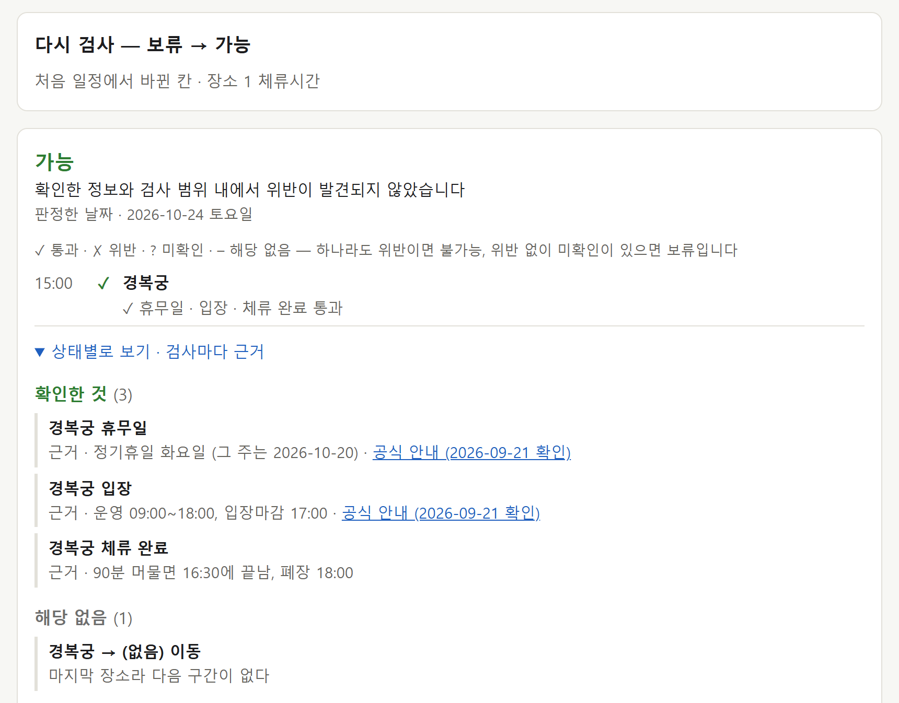
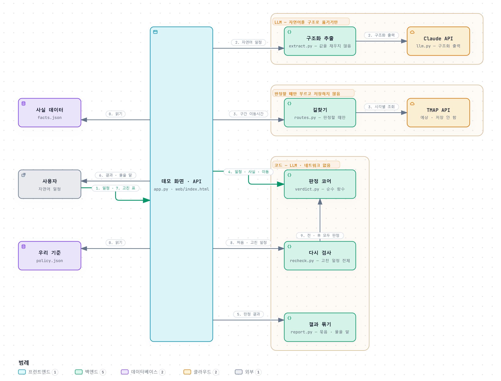

# itinerary-verifier

[](https://github.com/jeongrolee-tech/itinerary-verifier/actions/workflows/tests.yml)

여행 일정이 실제로 실행 가능한지 검증한다. 검사마다 **통과 · 위반 · 미확인 · 해당 없음**을 근거와 함께 내고,
확인하지 못한 것을 확인했다고 말하지 않는다.

> Checks whether a travel itinerary is actually executable — validates opening hours,
> closures and transit times against official sources, and **reports what it could not verify**.



[문제](#문제) · [지원 범위](#지원-범위) · [핵심 설계](#핵심-설계) · [대표 실패 사례와 수정](#대표-실패-사례와-수정) ·
[평가 — 조건과 한계](#평가--조건과-한계) · [실행](#실행) · [더 보기](#더-보기)

용어가 낯설면 [`docs/용어.md`](docs/용어.md)부터 보면 된다.

## 문제

여행 전에 갈 곳마다 공식 페이지를 찾아 휴무일과 운영시간을 확인하는 데 시간이 오래 걸린다. 블로그의
"월요일 휴관이래요"는 맞는지 알 수 없고, 그렇게 확정해도 현장에서 틀어질지는 끝까지 모른다. 운영정보는 바뀌므로
모든 근거에 확인한 날과 적용 기간을 붙이고, 방문일이 그 기간을 벗어나면 판정하지 않는다.

이 프로젝트의 질문은 **이 확인을 LLM에 맡기면 어디까지 되나**였다. 답은 "맡기면 안 되는 단계가 있다"였다 — 같은 사실을
줘도 LLM은 판정 규칙을 실행마다 다르게 놓쳤다([핵심 설계](#llm은-옮겨-적고-판정은-코드가-한다)). 그래서 LLM은 자연어를
구조로 옮기는 데만 쓰고, 근거가 충분한지와 실행 가능한지는 코드가 판정한다.

정답을 판정 코드가 아니라 공식 페이지 문구로 만들어야 해서, 그 출처를 직접 읽을 수 있는 **서울**로 좁혔다.

## 지원 범위

**목표 범위** — 서울 · 당일 · 장소 3\~6곳 · 대중교통. 해외 도시 · 1박 이상 · 예약 · 예산 · 날씨 · 동선 최적화 · 다국어 ·
자동차는 뺐다.

**운영정보를 확정하는 장소** — 경복궁 · 창덕궁 · 덕수궁 · 종묘 · 서울시립미술관 서소문본관. 근거는 공식 페이지에서 옮겼고
2026-12-31까지 쓴다. 광장시장 · 청계천 · 덕수궁 돌담길 · 북촌한옥마을은 공식 정보나 상시 개방 근거가 없어 미확인으로 묻고,
목록 밖 장소도 미확인이다. 장소마다 무엇이 확정되는지는 [`docs/데이터-소스.md`](docs/데이터-소스.md#지원-범위-자세히)에 있다.

**이동시간** — 실제로 쓸 때는 판정하는 순간 TMAP 예상 이동시간을 받아 쓰고 저장하지 않는다(약관상 24시간 넘게 쓸 수 없다).
정답 문제는 테스트용 이동시간을 적어 둔 12건이면 그 값을, 나머지는 저장해 둔 지하철 최소 이동시간을 쓴다.

'가능'은 아래 "검사하는 것" 중 어긋난 것을 찾지 못했다는 뜻이다. "검사하지 않는 것"은 보장하지 않는다.

| 검사하는 것 | 검사하지 않는 것 |
| --- | --- |
| 휴무일 — 정기휴일, 고정 휴관일, 공휴일이 겹칠 때의 기관별 규칙 | 식당 대기시간 · 혼잡도 — 공식 출처가 없다 |
| 입장 — 운영시간, 입장마감, 계절·공휴일 시간표 | 당일 임시 휴무 · 행사 · 현장 상황 — 근거는 확인한 날의 공식 안내 페이지다 |
| 체류 완료 — 사용자가 말한 체류시간이 폐장 전에 끝나나 | 예약 필요 여부 · 매진 · 가격 · 날씨 |
| 이동 — 판정할 때 TMAP 예상 이동시간(대중교통 · 도보 · 택시). TMAP 없이 돌리면 지하철 최소 이동시간 | 사용자가 고른 이동수단으로 되는지 — 대중교통 · 도보 · 택시 중 하나로라도 갈 수 있으면 된다고 본다. 택시를 안 탄다고 했으면 택시만 뺀다 |
| 필수 일정 — 사용자가 "꼭" 지킨다고 한 열차 등의 시각. 지금은 하루 마지막 교통편만 판정하고, 하루 중간의 약속과 하루 끝 필수 일정이 둘 이상인 경우(같은 시각 서울역 · 용산역 열차)는 미확인으로 알린다 | 동선 최적화 · 수정안 자동 생성 — 사용자가 고친 일정을 다시 검사하는 것까지만 한다 |
| 입력 — 날짜 · 장소 · 시각이 있나, 날짜와 요일이 맞나 | |

사용자가 말한 조건도 지킨다. "택시는 안 타요"면 택시를 빼고 보고, "문 닫은 거 알아요, 앞에서 쉬다 갈게요"면 그 장소는
입장하지 않는 것으로 보고 휴무일 · 입장 · 체류를 보지 않는다(화면의 '입장 안 함').

들어갈 시각을 말하지 않은 장소("그다음 창덕궁에서 한 시간 반")는 앞 장소를 나와 바로 갔을 때로 확인한다. 되면 묻지 않고
"창덕궁에는 11:30에 들어가면 돼요"처럼 확인한 시각을 알리고, 계산할 수 없으면 시각을 묻는다. 뒤 이동시간은 그 시각에 나설 때만
확인해서 넓은 시간대로 알리지 않는다. 마지막 장소라 끝이 폐장 · 입장마감으로만 정해지면 "11:30\~16:00 사이"처럼 알린다.

## 핵심 설계

### 결과를 넷으로 나누고, 가장 나쁜 상태로 접는다

```
검사 하나            통과        근거를 확보했고 조건을 만족했다
                     위반        확보한 근거에서 위반이 확인됐다
                     미확인      검사가 필요한데 끝내지 못했다
                     해당 없음   검사할 필요가 없다

일정 전체            불가능      위반이 하나라도 있다
                     보류        위반은 없지만 미확인이 있다
                     가능        필요한 검사가 모두 통과했다
```

미확인을 무시하고 "대부분 통과했으니 가능"을 내면, 확인하지 않은 것을 확인했다고 말하는 서비스가 된다. 해당 없음은
볼 필요가 없을 때(쉬는 날의 입장 같은)만 쓰고, 해야 하는데 못 한 검사는 미확인이다. 그래서 사용자에게도 "실행 가능한
일정입니다"가 아니라 **"확인한 정보와 검사 범위 내에서 위반이 발견되지 않았습니다"**라고 말한다.

### LLM은 옮겨 적고, 판정은 코드가 한다

| 단계 | 담당 | 이유 |
| --- | --- | --- |
| 자연어 → 구조화 | LLM ([`core/extract.py`](core/extract.py)) | 표현이 다양해 규칙으로 못 잡는다. 입력에 없는 값은 채우지 않고 비워 둔다 |
| 운영정보 · 이동시간 조회 | 코드 | 공식 출처에서 옮긴 사실 데이터, 판정할 때 부르는 TMAP |
| 근거 충분성 · 실행 가능 여부 | 코드 ([`core/verdict.py`](core/verdict.py)) | 같은 입력이면 언제나 같은 규칙을 같게 적용해야 한다 |

판정 코어를 따로 둔 것은 비교 실험에서 줄이려던 **규칙 적용 오류** 때문이다. 같은 사실 데이터를 받은 LLM은 실행마다
다른 규칙을 놓쳤다. 10월 2일 실행에서는 T01에서 지하철 최소 이동시간을 실제 이동처럼 썼고, 10월 7일에는 T15 · T24에서
공휴일 시간표를 놓쳤고, 10월 12일에 받은 응답은 T15만 놓쳤다. 검사 하나를 위반이라고 해 놓고 전체를 가능이라고 낸 답(T27)도
있었다. 10월 28일에는 3차 피드백대로 LLM에도 판정 코드와 같은 규칙을 글로 주자 37문제를 검사까지 모두 맞혔다. 그래도 같은 요청을
새로 세 번 부르면 T28에서 두 번 검사를 틀렸다 — 규칙을 알려 줘도 적용이 호출마다 흔들린다. 판정 코어는 같은 입력이면 언제나 같은
답이고, 네트워크를 부르지 않는 순수 함수라 API 없이 같은 입력으로 테스트할 수 있다.

### 근거를 셋으로 나눈다

| | 어디에 | 예 |
| --- | --- | --- |
| 사실 | [`core/facts.json`](core/facts.json) — 공식 페이지에서 옮기고 확인한 날 · 적용 기간을 붙인다 | 창덕궁 정기휴일 월요일 |
| 우리 기준 | [`core/policy.json`](core/policy.json) — 설정이지 사실이 아니다 | 권장 여유 구간 10분 · 열차 15분 |
| 사용자 입력 | 구조화한 일정 — 말한 값 · 추정한 값 · 없는 값을 나눈다 | "점심 먹고" → 12:00 (추정) |

위반은 사실과 사용자가 말한 값만으로 증명될 때 낸다. 우리 기준이나 추정한 값으로 결론이 달라지면 미확인이다 — 예상
이동시간으로는 늦을 것 같아도 이동 0분이면 닿는 일정은 위반이 아니고, "20:30 KTX"(사용자)와 "15분 전 도착"(우리 기준)은
따로 남긴다. 규칙 전체와 규칙마다 없으면 무엇이 깨지는지는 [`docs/판정-규칙.md`](docs/판정-규칙.md)에 있다.



선 이름의 숫자는 순서다 — 처음 검사가 1\~6, 표에서 고쳐 다시 검사하면 7\~9, 0은 서버를 켤 때 한 번 읽는 것이다.
LLM은 구조화 추출 한 칸에만 있고, 판정 코어 · 다시 검사 · 결과 묶기는 LLM과 네트워크 없이 돈다. 길찾기는 판정할 때만
TMAP을 부르고 저장하지 않는다. 상자를 누르면 근거 코드 줄로 가는 대화형 버전은 [`docs/architecture.html`](docs/architecture.html)이다
(내려받아 브라우저로 연다. [archify](https://github.com/tt-a1i/archify)로 만들었다).

## 대표 실패 사례와 수정

멘토 반례(3차 피드백)와 새 평가에서 찾은 실패다. 고친 것마다 실패하는 테스트를 먼저 남기고(`xfail(strict=True)`) 고친 뒤
지웠다 — [`tests/test_counterexamples.py`](tests/test_counterexamples.py).

| 실패 | 무엇이 틀렸나 | 고친 뒤 | 커밋 |
| --- | --- | --- | --- |
| 같은 장소 재방문 | 이동시간을 '출발\|도착' 하나에 저장해 오후 10분이 오전 45분을 덮어썼다. 늦을 일정을 가능으로 냈다 | 구간 번호별로 저장하고, 받은 날짜 · 출발 시각이 같을 때만 다시 쓴다 | `1eea7d2` |
| 입력 일부 누락 | 시각 없는 덕수궁 하나 때문에 2026-01-01 미술관 휴관 위반이 사라졌다 | 필요한 입력이 있는 검사는 계속한다 | `b11e840` |
| 하루 중간 약속 | 정오 약속을 마지막 장소(16:00 퇴장)에서 계산해 위반을 냈다 | 하루 중간 약속은 미확인으로 알리고, 그 사이 이동도 미확인이다 | `d619dae` · `a0bbf28` |
| 재검사 입력 | 체류 -60분으로 가능, 문자열 "60"은 서버 오류 500 | 추출 결과와 같은 일정 모델로 검증해 422로 거절한다 | `3fbc3f4` |
| 열차 시각 모름 | "KTX 꼭 타야 하는데 시간은 몰라요"가 422이거나 결과에서 KTX가 사라졌다 | 조건을 남기고 시각을 묻는다. 추정한 시각으로는 확정하지 않는다 | `305bb67` |
| 시각 빠진 장소 | 시각 없는 창덕궁의 휴무일까지 보지 않았다. 쉬는 날이어도 위반을 놓쳐, 다른 위반이 없으면 보류를 낸다 | 휴무일은 날짜로 확인하고, 입장 · 체류는 시각을 묻는다 | `86329e6` |

마지막 줄(새 평가 N02)을 예로 들면 순서가 이렇다. 정답을 사람이 공식 근거로 먼저 정해 커밋했다(`be28679`). 판정 코드를
처음 돌리자 창덕궁 칸 셋이 비어 있었다(`a3682d5`, [첫 결과](docs/experiments/2026-10-23-new-eval-first-run.md)). 실패하는
테스트를 남기고(`7d381e5`) 고친 뒤(`86329e6`) 회귀셋 T34로 옮겼다(`c2855ee`). 이 사례의 입력이 추출 → 판정 → 결과 묶기 →
다시 검사를 지나며 어떻게 바뀌는지는 [`docs/코드로-따라가기-N02.md`](docs/코드로-따라가기-N02.md)에 코드 줄과 함께 따라갔다.

## 평가 — 조건과 한계

**세 숫자는 서로 다른 것을 잰다.**

| | 무엇을 쟀나 | 결과 | 조건 |
| --- | --- | --- | --- |
| 회귀셋 37건 | 사람이 쓴 구조화 일정을 넣으면 판정 코드가 정답과 같은 판정 · 검사를 내나 | 37/37, 기대 검사까지 모두 일치. **정답이 보류인 15건에서 가능으로 낸 것 0건** | 이동은 테스트용 값이거나 지하철 최소 이동시간이다. 정답 초안을 판정 코드를 함께 고쳐 온 Claude가 써서 독립 평가가 아니다 — 판정 규칙이 문서대로 구현됐는지 확인한 숫자다 |
| 새 평가 6건 | 정답을 판정 코드보다 먼저 정한 새 일정 | 첫 실행 판정 6/6 · 검사까지 4/6 → 고친 뒤 6/6. 자연어부터 끝까지 5/6(10-28) | 칸마다 사용자가 정했는지 Claude가 공식 문구로 정했는지 표시했다([워크시트](docs/new-eval-worksheet.md)). 고친 뒤 6/6은 코드를 맞춘 뒤라 독립이 아니다. 끝까지 5/6에서 틀린 N04는 구조화 추출이 열차 시각을 추정으로 적어 보류가 됐다 — 틀린 쪽이 안전한 쪽이다 |
| 비교 실험 | 같은 37건을 LLM 셋과 판정 코드로(10-28) | 판정 코드 37/37 · LLM에 사실 데이터 줌 37/37(검사까지) · '모르면 모른다' 지시 17/37 · 그냥 물음 18/37(보류인데 가능 13건) | LLM에도 판정 코드와 같은 판정 규칙을 글로 줬다(T15의 '공휴일 시간표 우선'을 전에는 코드만 알고 있었다). 이번 실행에서는 그 LLM이 판정 코드와 같아서, 이 구성에서 '코드가 더 높은 점수'라고는 말할 수 없다. 같은 요청을 새로 세 번 부르면 T28에서 두 번 검사 2개를 틀렸다(3차 피드백의 삼청동) |
| 실제 서비스 | 자연어 → 구조화 추출 → TMAP → 판정을 끝까지 | 따로 재지 않았다 | 구조화 추출은 37/37, 추출한 일정으로 판정해도 37/37(10-28, 이동은 테스트용). 애매한 시각 5문제를 세 번씩 새로 불러도 같은 답이었다. TMAP을 포함한 전체 시간과 비용은 실제 사용자 검토에서 잰다 — 아직 응해 줄 사람을 구하지 못했다. 블로그 후기 5개를 넣어 본 [검토](docs/experiments/2026-10-19-real-itinerary-review.md)(10-19)에서는 다섯 다 시각이 빠져 첫 결과가 보류였다 |

기록 — 세 기록이 같은 코드(`de33aa9`)에서 나왔다. 회귀셋 [`core/last-run.json`](core/last-run.json) `run-20261028-174205` · 구조화 추출
[`core/last-extract-run.json`](core/last-extract-run.json) `extract-20261028-162932` · 비교 실험 [`core/last-compare.json`](core/last-compare.json)
`cmp-20261028-170150` · 새 평가 [`core/last-run-eval-new.json`](core/last-run-eval-new.json)(첫 실행 `run-20261023-091509`는
[기록 문서](docs/experiments/2026-10-23-new-eval-first-run.md)에) · 다시 부른 기록 [`core/last-compare-stability.json`](core/last-compare-stability.json) ·
[`core/last-extract-stability.json`](core/last-extract-stability.json). 이번 유료 실행은 합계 $1.35였다.

**한계**

- 표본이 작다. '보류인데 가능 0건'은 "있다"를 확정하는 쪽이라 의미가 있지만, 정밀도 · 재현율은 신뢰구간이 넓고 정답이
  가능인 문제가 9건뿐이다.
- 이동시간은 테스트용 값이라, 판정 규칙이 맞는지를 보지 TMAP 예상이 맞는지를 보지 않는다.
- 비교 실험에서 'LLM에 사실 데이터 줌'은 37건을 10월 28일에 새로 받았고, 나머지 두 방식의 33건은 받아 둔 응답(10월 12 · 14일)을
  지금 코드로 다시 채점했다. 새로 불렀을 때의 흔들림은 비교 4문제 · 추출 5문제를 세 번씩만 쟀다(`--repeat`).

기록마다의 숫자와 읽는 법, 예전 숫자는 [`docs/평가-기록.md`](docs/평가-기록.md), 갈래별 보고는 [`docs/eval-report.md`](docs/eval-report.md),
회귀셋 37건 전부는 [`docs/정답-문제.md`](docs/정답-문제.md)에 있다.

## 실행

**필요한 것** — Python 3.10 이상. 조회 스크립트(`.mjs`)를 돌릴 때만 Node 18 이상.

```bash
pip install -r requirements.txt     # anthropic, pydantic, fastapi, uvicorn, httpx, pytest

# 키 없이 — 판정 코드는 외부 API를 부르지 않는다
python core/run.py                          # 회귀셋 채점 + 실행 기록
python core/run.py --case T05               # 문제 하나 상세
python core/run.py --suite eval-new.json    # 새 평가 (기록은 따로 남는다)
pytest                                      # 규칙 테스트 — 회귀셋 · 반례 · 길찾기 · 구조화 추출 · 데모 API 등
python core/eval_report.py                  # 평가 보고 (docs/eval-report.md)

# Anthropic API 키 — 받아 둔 응답이 있으면 키도 돈도 들지 않는다(응답 캐시)
python core/run_extract.py                  # 자연어 → 구조화 추출 → 판정
python core/compare.py                      # 비교 실험 — 비교 방식 넷
python core/compare.py --repeat 5           # 새로 불러 흔들림 재기 (돈이 든다)
python core/app.py                          # 데모 화면 http://127.0.0.1:8001 — TMAP 키는 있으면 쓴다

# Anthropic API 키 + TMAP 앱 키
python core/verify.py "10월 8일 목요일 …"   # 일정 하나를 끝까지 검증 — 아무것도 저장하지 않는다

# 데이터를 다시 받거나 API 능력을 확인할 때
python core/fetch_holidays.py 2026          # 공휴일 (공공데이터포털 키)
node check-tmap-api.mjs                     # TMAP 수단별 경로 (TMAP 키)
GKEY=... node check-places-api.mjs          # Google — 판정에는 쓰지 않는다
```

**돈이 드는 실행은 부르기 전에 묻는다.** `run_extract.py`와 `compare.py`는 모델에 보낼 내용이 받아 둔 응답
(`core/response-cache.json`)과 같으면 그 응답을 쓰고, 새로 부를 호출이 있으면 몇 건이고 얼마쯤인지 보여 준 뒤 `y`를 받는다.
나간 돈은 실행마다 찍는다(`core/spend.py`).

키는 환경변수에 없으면 실행할 때 물어본다 — 화면과 셸 히스토리에 남지 않는다. GitHub에 올릴 때마다 같은 `pytest`가
Python 3.10 · 3.13에서 돈다(GitHub Actions). 외부 API를 부르지 않아 키가 필요 없다.

## 더 보기

| 문서 | 내용 |
| --- | --- |
| [`docs/용어.md`](docs/용어.md) | 용어와 코드 값(`feasible` · `holdout` 등)의 대응표 |
| [`docs/판정-규칙.md`](docs/판정-규칙.md) | 판정 규칙 전부와 없으면 무엇이 깨지나 |
| [`docs/코드로-따라가기-N02.md`](docs/코드로-따라가기-N02.md) | 고친 반례 하나(N02)를 extract → to_itinerary → judge → report → recheck 코드로 따라가기 |
| [`docs/정답-문제.md`](docs/정답-문제.md) | 회귀셋 37건 — 입력 · 정답 · 잡아내는 것 |
| [`docs/new-eval-worksheet.md`](docs/new-eval-worksheet.md) | 새 평가 6건의 정답 · 근거 · 누가 정했나 |
| [`docs/평가-기록.md`](docs/평가-기록.md) | 기록마다의 숫자와 읽는 법, 비교 실험 풀이, 예전 숫자 |
| [`docs/eval-report.md`](docs/eval-report.md) | 평가 보고 — 오류 유형 · 검사별 채점 · 보류 원인 · 비용 (자동 생성) |
| [`docs/데이터-소스.md`](docs/데이터-소스.md) | 출처와 이용 조건, 이동시간 설계, 장소별 지원 범위 |
| [`docs/data-policy.md`](docs/data-policy.md) | 제공사별 저장 · 공개 범위 |
| [`docs/돌려보기.md`](docs/돌려보기.md) | 판정 세 가지의 실행 예와 데모 화면 |
| [`docs/파일별-역할.md`](docs/파일별-역할.md) | 파일 목록과 파일마다의 중요한 결정 |
| [`docs/개발-과정.md`](docs/개발-과정.md) | 다섯 번의 설계 수정, 최근 완료, 더 멀리 |
| [`docs/experiments/`](docs/experiments/) | 실험 기록 — 폐기한 후보와 그 이유 |

## 남은 작업

| | 왜 |
| --- | --- |
| 실제 사용자 검토 | 일정을 짠 사람 2\~3명이 직접 넣고 고쳐 보며 시간과 비용을 남긴다. 아직 응해 줄 사람을 구하지 못해 [진행 방법과 기록 양식](docs/experiments/user-review.md)만 준비했다 |
| 하루 중간 필수 일정을 앞뒤 장소와 잇기 | 지금은 하루 마지막 교통편만 판정하고, 하루 중간 약속과 그 사이 이동은 미확인으로 알린다 |
| 기차 · 버스를 "꼭" 없이도 필수 일정으로 | 실제 후기 두 개에서 밤 10시 버스와 19:44 KTX가 필수 일정으로 뽑히지 않아 마감 검사를 하지 않았다 ([실제 일정 검토](docs/experiments/2026-10-19-real-itinerary-review.md)) |
| 뒤 문장이 정하는 시각의 출처 | 새 평가 N04 "8시 반에 서울역에서 KTX를 꼭 타야 해서, 그 전에 오후 2시에 …"의 8시 반을 구조화 추출이 추정으로 적었다(정답은 말한 시각). 추출 규칙 2번이 뒤 문장으로 정해지는 시각을 말하지 않는다. 고치면 추출을 다시 받아야 한다 |
| 특별 운영(야간관람 · 행사) | 7월 토요일 19:30 경복궁 같은 야간관람 일정을 정규 시간표의 입장마감으로 불가능이라고 확정한다. 실제로는 들어갈 수 있다 |
| 수정안 자동 생성 | 표에서 고친 일정을 다시 검사하는 것까지만 한다 |

## 라이선스

**저작권자가 모든 권리를 보유한다.** 이 저장소는 열람용으로 공개한 것이고,
사전 동의 없이 복제·수정·배포·2차적 저작물 작성은 할 수 없다.

포함된 제3자 데이터는 여기에 해당하지 않고 각 제공처의 조건을 따른다 —
지하철 데이터는 **공공누리 1유형(출처표시)**, 공휴일 데이터는 **이용허락범위 제한 없음**이다.
내용을 인용하거나 참조할 때 지하철 데이터의 출처 표시는 그대로 유지해야 한다.
전문은 [`LICENSE`](LICENSE)에 있다.

Google Maps Platform·TMAP 응답은 약관상 저장이 안 되므로 저장소에 없다 —
근거는 [`docs/data-policy.md`](docs/data-policy.md).
